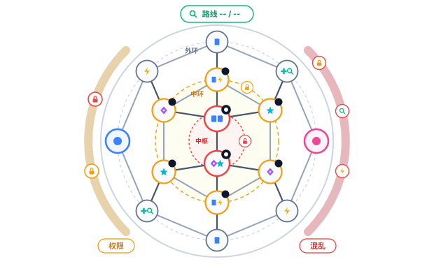
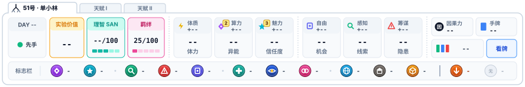
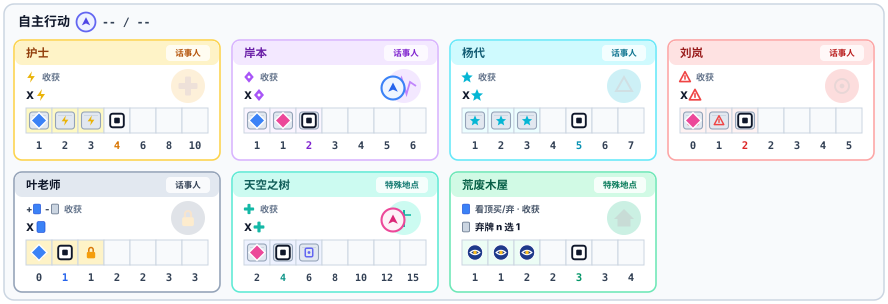
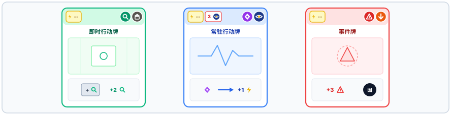
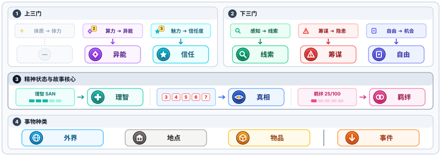
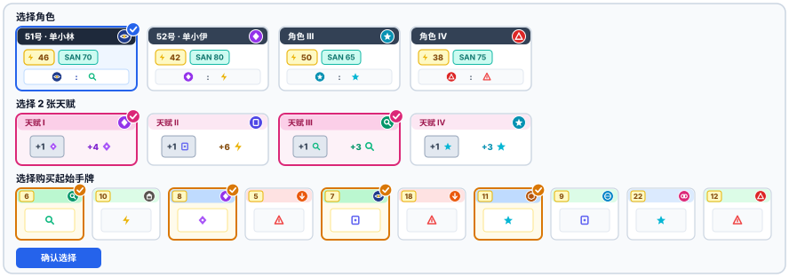
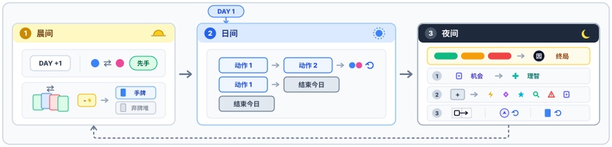
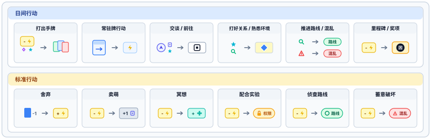

# 白屋总纲

《白屋》是由科幻悬疑小说《苍白有瑕的囚笼》第一卷改编的单机游戏，结合了**像素箱庭叙事 RPG（类《杀戮天使》式的封闭空间探索演出）**与**卡牌构筑、资源运营的策略玩法**。

《白屋》游戏的核心目标受众有两类：
1. 对科幻、悬疑、二次元剧情向游戏（如叙事向像素 RPG、AVG）有好感的受众，即希望沉浸于故事氛围，与虚拟角色建立感情羁绊，并对故事代入思考的玩家。
2. 在卡牌构筑、资源运营的玩法中获得乐趣的玩家。

玩法的核心目标是：
1. 将故事发生的关键节点、叙事目标包装入卡牌文案与效果中，让玩家在组牌和出牌的过程中自然消化剧情，提高叙事沉浸感。
2. 用资源的紧缺与调配还原主角身处绝境时的真实压力，使玩家在牌局里的每一次权衡都与人物在故事里的处境合拍。

## 一、游戏主题

《白屋》由小说《苍白有瑕的囚笼》第一卷《逃离圣心医院》改编。为了让初次接触本项目的读者清楚理解游戏要传达的核心体验，以下先从原作全书与第一卷的故事脉络说起：

1. **原作全书（共七卷）的世界观与核心主题**  
   《苍白有瑕的囚笼》是一部围绕**“自由意志、真实与虚幻、以及爱与双向救赎”**展开的科幻幻想长篇，共分七卷（各卷梗概见文末“终、原作简介”）。  
   故事的每个大篇章都有各自独立的舞台与议题：主角兄妹从封闭的地下实验机构起步，此后将走入由超级 AI 裁定集体利益的未来都市、让人甘愿沉溺其中的虚拟现实游戏、以及秩序失落的战火之地，在旅途中直面个体愿望与集体秩序、虚拟幻梦与残酷现实、人性私欲与和平信仰之间的重重碰撞。  
   而在层层递进的冒险尽头，世界最底层的真相被最终揭开：他们身处的整个世界，其实是第四面墙之外一位孤独、渴望爱与自由的“作者（神明）”笔下构筑的故事；作者抹去记忆走入自己织就的幻梦（化身为哥哥），而当墙外的作者陷入绝境、故事世界随之濒临崩塌时，被创造出来的主角（妹妹）不再只是听凭摆布的纸面人物——贯穿全书的总目标，正是兄妹二人从故事最初的起点（书中称为“世界的零”）出发，穿梭于不同层面的世界（“境界面”），将沿途所有人与物的思念、自由信念与羁绊汇聚为“因果力”，最终打破第四面墙，反过来拯救创世的神明。

2. **第一卷《逃离圣心医院》的故事内容与叙事目标**  
   作为全书的开篇，第一卷的核心情感是**“绝望中的生机”**：失去所有记忆的少年在一间四面纯白、没有门窗的地下病房里醒来，只有一个实验体编号；一墙之隔的房间里，关着另一个自称是他妹妹的少女。囚禁他们的“圣心医院”是一座秘密进行精神异能实验的机构，内部各方势力围绕实验体与上层利益暗流涌动，用冷酷的规训、测试与甜头操控着被关押的少年少女。  
   这一卷采用明暗双线并行：明线是手无寸铁的兄妹俩如何借隔墙心灵交流的能力，在各方势力的利用与监控下周旋博弈，最终联手逃出圣心医院；暗线则是两人的情感距离——在高压求生中，两人既彼此依赖，又因各自隐瞒伤痛、被迫做出违心妥协而产生隔阂与怀疑，在信任与试探间反复拉扯，直至终局高潮彻底敞开心扉，展现出双方的智慧、坚韧与不可替代的羁绊。

**故而，改编游戏《白屋》的叙事目标顺着玩家的体验过程确立为三点：**
1. **立住封闭机构的悬疑与求生压迫感（明线破局）**：玩家开局与失忆的主角处在同一起点，操纵渺小的角色置身于空旷冷峻的纯白病房与走廊中。通过亲身走动观察、经历查房管控与残酷的异能评估，一步步摸清医院各方势力的危险底细，生出强烈的逃生紧迫感。
2. **写实兄妹从试探、隔阂到生死相托的拉扯（暗线羁绊）**：一道厚实的白墙将画面左右两个狭小房间隔开，起初隔壁传来的只是一个陌生少女的声音。随着两人在夜里贴墙交谈、在危机中暗中配合，又在两难处境下为了护住对方而各自咽下委屈、撒谎隐瞒甚至引发信任危机，让玩家在拉扯中心疼并认下这个鲜活的角色，最终在并肩破局的高潮里完成情感弧光。
3. **藏好通往后续篇章的伏笔（呼应“世界的零”）**：在完整讲好“逃出圣心医院”这一独立故事的同时，将主角对年幼躯壳的微妙违和感、玩笑般提起的“通晓因果之力”以及外界都市的暗流自然融进细节，为白屋之外更广阔的世界留足悬念。

## 二、核心玩法总览

围绕上述两类受众与三条叙事目标，《白屋》划分为两个独立又互通的模式：**专注故事演出的「剧情模式」**，以及**专注策略重玩的「硬核模式」**。

- **剧情模式**以 2D 像素箱庭与对话演出的形式完整呈现第一卷故事。玩家无需分心计算牌局，只需顺着剧本走入主角兄妹的处境，亲历整场求生周旋与情感拉扯。
- **硬核模式**在主菜单独立开启，将整座圣心医院浓缩到一张策略牌桌上。玩家通过卡牌构筑与资源调配，模拟实验体日复一日积攒筹码、周旋各方直至逃离医院的全过程，支持单人模式与双人对战。

两个模式通过 **【记忆】碎片** 相连。玩家在剧情模式中亲历的关键瞬间与发现的隐秘细节，都会化作带有插画和故事短句的【记忆】碎片永久收入图鉴。进入硬核模式后，这些【记忆】碎片会展现完整的策略卡牌效果——玩家可在系统基础牌包之外，自由勾选自己收集到的【记忆】碎片加入抽牌堆，让故事里的经历成为牌桌上的筹码。

---

## 三、剧情模式

重度策略玩法已独立放在硬核模式中，因此剧情模式的目标很纯粹：让没读过原作的玩家，顺着第一卷紧凑的悬疑节奏“亲身活过”主角兄妹在圣心医院里的经历。在此之上，让玩家的探索与选择真正起作用，并在不打扰演出的前提下，帮新玩家顺手认熟硬核模式的概念。

画面采用类《杀戮天使》的 2D 像素箱庭配对话框头像表情差分。玩家平时操纵失忆少年（实验体 51 号），到了关键转折篇章则会切换操控一墙之隔的妹妹（实验体 52 号）。相比只有半身立绘的传统文字游戏，像素箱庭能用空旷冷白的病房与渺小人物的反差直接立住压迫感。在病房戏份中，厚重的白墙位于画面正中央，左右同屏展现两间病房——比如哥哥在墙这边嘴上逞强说没事，妹妹在墙那边独自缩在角落沉默，心理距离一眼可见。人物不敢明说的潜台词交给小人的停顿、后退等微动作去表现。到了关键时刻，则由玩家亲手按键一步步走到白墙边回应敲击，把那一刻的心理分量落到玩家手上。

流程上直接省去平淡重复的关押日常，按戏剧冲突切分章节。遇到异能测试、受罚施压或突围这类高潮戏份，游戏会收起无关跑图，让镜头与剧情一口气推到底。到了风波过后的病房夜晚、安静走廊或短暂外出间隙，则完全开放当前场景供玩家自由走动。只想看主线的玩家直接交互推进点就能进入下一幕，愿意细品的玩家则可以在角落自由调查，触发额外的独白与兄妹闲聊，并拾取散落的 **【记忆】碎片**。

在主线与自由度的平衡上，何时测试、何时被院方传唤属于不可更改的外部日程，用来托住严密的悬疑主干。主角面对风波时的态度与追查深度，则完全交由玩家自己决定：

- **对妹妹的态度牵动【羁绊】**：面对院方的甜头与威胁，选择硬撑护短、夜里坦诚交心会加深【羁绊】，顺从妥协、隐瞒欺骗则会扣减【羁绊】。这不仅会改变日常对话的温度，在切换为妹妹视角时，玩家还会亲眼看到自己此前选择留下的后果。即使前中期在高压下让【羁绊】跌至冰点，故事后半程也留有付出沉重代价敞开心扉的转折节点，能把关系重新拉回来。
- **追查秘密的深浅牵动【理智】与【真相】**：失忆的主角一旦强行回想过往或深究医院黑幕，就会引发剧烈头痛。遇到这类深层线索时，画面震颤与耳鸣会提示精神负荷：玩家可以及时停手保住【理智】，也可以顶着痛苦继续深想（消耗【理智】）来揭开 **【真相】**、拿到珍稀碎片。一旦【真相】被点亮，后续面对院内人物时还会解锁识破谎言、追问底细的新对话。反之，若此前【理智】已经透支过度，主角就会因剧痛中断追想，错过这段秘密。
- **终章收束为三类结局**：一路积累的【真相】与最终的【羁绊】将在终章决定故事走向——安于优待规训、最终放弃逃亡的坏结局，逃出医院却留有身世迷茫或兄妹隔阂的普通结局，以及看穿底牌、兄妹生死同心冲破封锁的真结局（同时揭开白屋之外世界的序幕）。游戏按章节保存进度节点，方便玩家随时跳回重走其他分支、收齐碎片。

最后，主角在设定上本就是被医院时刻监测的实验样本。平时演出画面干干净净，不挂常驻数值栏。只有当主角顺着剧情做完测试、与院内关键人物打交道或做出选择时，画面角落才会轻轻浮现简短的状态变化记录（比如【实验价值】、【权限】、【理智】或【羁绊】的升降）与人物互动提示。玩家平时也可以随时在菜单里查看当前状态和每枚【记忆】碎片附带的卡牌标志。全程没有任何卡住剧情的数值门槛，玩家安安静静看完一遍故事，硬核模式的核心概念和自己的扩展牌池也就自然认熟了。

---

## 四、硬核模式系统设计

硬核模式的牌桌由三块区域组成：正中央是**圣心医院三环地图与三条共享的越狱进度条**，外围摆放着院内**【话事人】与外部【特殊地点】**公共面板，每位玩家面前则是自己的**个人状态面板与手牌区**。对局以**「一天」**为一个完整大回合，玩家每天通过打出手牌、与各方人物周旋或探索特殊地点来壮大自身能力、积攒筹码，直至推满中央的越狱条件冲出医院，并在终局按各自汇聚的总 **【因果力】** 评定胜负。

### 1. 中央地图、全局三进度条与终局结算

#### （1）中央三环地图与全局三进度条
牌桌中央铺设圣心医院由外向内嵌套的**同心三环地图**（依次为：外环普通病房区 ➔ 中环特护与办公区 ➔ 中枢核心设施区），外圈围绕着全场共享的三根越狱进度条：

- **【路线】**：代表摸清医院逃生通道的进度。玩家消耗手头积累的【线索】（或通过卡牌、公共标准行动）在地图上由外向内点亮相邻节点。每点亮一处，就推进 1 格【路线】，并当场拿走该节点印制的【收获】与终局得分。内圈的中环与中枢设有【权限】限制——当全局【权限】尚未达到中环或中枢要求的刻度时，若玩家强行越权点亮内圈节点，必须额外付出精神代价（扣除 **【理智】**）。
- **【权限】**：代表在院内挣得的通行层级。个人面板不会每天自动产出【权限】，只能通过打出对应卡牌、与院内最高主事人（叶老师）打好关系、或执行公共标准行动来一格格提升。当【权限】升至指定刻度时，依次解开中央地图中环与中枢的限制。
- **【混乱】**：代表医院内部监控与运转秩序的失控程度。玩家通过引爆日常埋下的【隐患】、打出事件牌或执行公共标准行动来推进刻度。轨道特定格子上印有先到先得的【收获】，部分卡牌也要求全局【混乱】达到指定高度才能打出。

每当玩家将【路线】、【权限】或【混乱】往前推进 1 格，都会当场提升 1 点自身的 **【实验价值】**。

#### （2）终局触发与总分【因果力】构成
当某一天内【路线】、【权限】、【混乱】三根全局进度条**全部推至满格**时，越狱条件即告达成，该天即为本局的最后一天。完整走完当天的剩余流程后，对局结束并进入终局结算：
- **单人模式（PvE）**：玩家需在规定天数上限内独自将三根进度条全部推满（若最后一天结束时仍有任意一根未满，则越狱失败直接判负），成功逃出后按总【因果力】评定通关等级。
- **双人对战（1v1 PvP）**：两名玩家身处同一座医院，共享中央地图与三根进度条，既相互借力推开逃生大门，又争抢关键节点与外围资源。对局结束时比较双方的总【因果力】，高者获胜。

终局结算时，每位玩家的总 **【因果力】** 由四部分相加得出：
1. 玩家最终的 **【实验价值】**。
2. 中央三环地图上由该玩家点亮的区域节点得分。
3. 玩家已打出卡牌提供的终局得分（含常规牌固定得分、【真相】高阶牌固定得分、以及按最终【羁绊】点数换算的核心大牌得分）。
4. 公共 **「里程碑」**（对局中率先达成指定突破目标并宣告锁定的先手奖励分）与 **「奖项」**（对局中花体力开启某项比拼赛道、终局按双方在该赛道上的排名结算的奖励分）。

---

### 2. 个人状态与资源面板

每位玩家面前设有一块个人状态面板。左侧为三项核心状态，右侧六门资源统一采用 **「上方人物属性（决定每晚自动产出的能力）➔ 下方资源库存（平时积攒并消耗的筹码）」** 的对应结构：

#### （1）核心状态（3 项）
- **【实验价值】**：院方对实验体当前重要性的评级。既是每晚补充基础【体力】的计算基数，也是终局结算【因果力】的基础底分。
- **【理智】**（即 San 值，固定上限 **100**）：实验体的精神承受防线，不同角色的开局【理智】不同且通常不满 100。玩家主动执行任何需消耗【理智】的出牌或越权探路行动时，当前剩余【理智】必须足够支付。**一旦【理智】扣至 0，角色将陷入疯狂状态——除公共【标准行动】外无法执行任何其他操作，直至【理智】恢复为止。**
- **【羁绊】**（开局初始值 **25**，范围 **0～100**）：实验体与同伴之间的情感信任刻度，无每日自动产出，随局内卡牌抉择双向增减，直接关联【羁绊】体系的局内收益与终局大牌计分。

#### （2）上三门（主要用于买牌与抵扣打牌费用）
- **【体质】➔【体力】**：【体力】是最核心的通用行动力——购买手牌、白天打出绝大多数卡牌、以及执行公共标准行动都要消耗【体力】。每晚休整时，按 `【实验价值】＋【体质】` 之和补充【体力】。【体质】是全部面板属性中唯一允许降为负数的维度，用来表现实验体受刑虚弱、靠透支硬撑的绝境。
- **【算力】➔【异能】**：代表大脑解析与编码特殊脑波的效率，每晚按【算力】产出【异能】并跨天累积。打出带有 **【异能】标志** 的卡牌时，可用手头的【异能】抵扣【体力】费用（默认 `1 点【异能】抵扣 2 点【体力】`）。
- **【魅力】➔【信任度】**：代表言谈伪装与拿捏人心的水准，每晚按【魅力】产出【信任度】并跨天累积。打出带有 **【信任】标志** 的卡牌时，可用【信任度】抵扣【体力】费用（默认 `1 点【信任度】抵扣 3 点【体力】`）。此外，【信任度】还专门用于在外围与【话事人】打好关系，以及吸引已打好关系的话事人主动来病房交谈。

#### （3）下三门（主要用于外围行动与推进全局进度条）
- **【自由】➔【机会】**：代表在看守缝隙中挣得的活动余地，每晚按当前【自由】刷新新一天的可支配【机会】。白天可花【机会】执行外围【自主行动】。**当一天结束进入夜晚时，手头没花掉的闲置【机会】代表留在病房安静歇息，会自动清空并等额恢复【理智】（不超过上限 100）。**
- **【感知】➔【线索】**：代表日常留心观察积累的情报，每晚按【感知】产出【线索】并跨天累积。攒够定额【线索】后，既可在中央地图点亮相邻节点推进【路线】，也可用于购买外围【特殊地点】的地图以熟悉环境。
- **【筹谋】➔【隐患】**：代表暗中设局留下的后手，每晚按【筹谋】产出【隐患】并跨天累积。攒够定额【隐患】后，可在院内引爆事故推进全局【混乱】进度条。

---

### 3. 外围【自主行动】：【话事人】与【特殊地点】

实验体要想逃出圣心医院，除了在病房内积蓄力量，还必须与院内各怀私心的主事人物周旋，并抓住有限的外出机会摸清环境。牌桌外围为此分设院内 **【话事人】** 与外部 **【特殊地点】** 两栏公共面板，所有从这些面板拿到的回报统称为 **【收获】**。

#### （1）轨道收益变化与访问次数限制
- 每块面板下方都印有一条从左到右收益逐格递增的轨道，上面放有一枚指示当前档位的游标。若某块面板一整天都无人访问，夜晚结算时其游标自动向右移动一格。一旦有玩家前去访问，该玩家当场领走游标所在格的【收获】，随后游标退回左侧起始格（若左侧已有玩家的常驻标记，则停在最右侧一枚标记的右边第一格）。
- 每位【话事人】与每处【特殊地点】在同一天内最多只接待一次访问，先到先得，被访问后当天即关闭，次日重新开放。
- 每位玩家每天可执行的【自主行动】（含【交谈】与【前往】）设有基础总次数上限，仅能通过打出特定的高阶卡牌来增加。

#### （2）两类面板的具体操作
- **面对【话事人】**：
  1. **【打好关系】**：消耗定额 **【信任度】**，在该话事人面板左侧空位放上一枚个人标记（每人每处限占一格，总位置有限），当场获得对应的永久提升，并将游标每次回退的最低档位永久往右垫高一格。此后**每当任何玩家**与这位话事人【交谈】时，所有已与其打好关系的玩家都能同步拿一份固定【收获】。
  2. **【交谈】**：占用当日 1 次【自主行动】次数并消耗 **【机会】**，触发专属互动短句并拿走当前游标所在格的【收获】。若此前已经与该话事人【打好关系】，玩家**可以改用【信任度】替代【机会】与之【交谈】**（表现熟络后吸引对方主动来病房找你，仍正常占用当日 1 次【自主行动】次数）。
- **面对【特殊地点】**：
  1. **购买地图 /【熟悉环境】**：消耗定额 **【线索】** 购买该特殊地点的地图并放上个人标记，当场获得对应的永久属性或标志，并将游标每次回退的最低档位永久往右垫高一格。此后**每当任何玩家**【前往】该地点时，所有已熟悉该处环境的玩家都能同步拿一份固定【收获】。
  2. **【前往】**：占用当日 1 次【自主行动】次数并消耗 **【机会】**（地点无法主动上门，不可用信任度替代），触发专属短句并拿走当前游标所在格的【收获】。

#### （3）首批 7 块外围面板配置表

| 类别 | 对象与身份定位 | 打好关系 / 熟悉环境当场【收获】 | 单次访问文本 | 交谈 / 前往轨道【收获】 | 有人访问时的常驻【收获】 |
| :--- | :--- | :--- | :--- | :--- | :--- |
| 话事人 | **【护士】** 负责实验体三餐配给与日常起居看护的专属护理员 | 提升 **【体质】** | **【得到了护士的悉心照料】** | 收获轨道对应的 **【体力】** | 收获固定量的小额 **【体力】** |
| 话事人 | **【岸本】** 负责脑波曲线拟合与调谐、醉心技术的核心骨干 | 提升 **【算力】** | **【得到了岸本的调谐指导】** | 收获轨道对应的 **【异能】** | 收获固定量的小额 **【异能】** |
| 话事人 | **【杨代】** 握有注资话语权、看重体面与外部政治收益的世家公子 | 提升 **【魅力】** | **【得到了杨代的赏识】** | 收获轨道对应的 **【信任度】** | 收获固定量的小额 **【信任度】** |
| 话事人 | **【刘岚】** 急于搏取功绩、敢于暗中与实验体密谋的项目负责人 | 提升 **【筹谋】** | **【与刘岚达成了私下默契】** | 收获轨道对应的 **【隐患】** | 收获固定量的小额 **【隐患】** |
| 话事人 | **【叶老师】** 掌控实验体生死与区域禁制的最高主事人 | 提升 **【权限】** | **【得到了叶老师的青睐】** | 收获轨道对应的 **【手牌】** | **摸一张手牌弃一张手牌** |
| 特殊地点 | **【天空之树】** 地底医院之上，繁华明亮的都市立体商业与交通中心 | 提升 **【自由】** | **【在天空之树得到了久违的放松】** | 收获轨道对应的 **【理智】** | 收获固定量的小额 **【理智】** |
| 特殊地点 | **【荒废木屋】** 地面荒园中，封存着前代实验体之王日记与遗物的旧木屋 | 获得 1 个 **【真相】标志** | **【在荒废木屋揭开了尘封往事的一角】** | **在弃牌堆里 n 选一，纳入手牌**（n 随轨道档位增大） | **看一张牌堆顶的牌，决定要不要买**（买则付体力留手，不买则弃入弃牌堆） |

---

### 4. 卡牌类型与标志体系

#### （1）卡牌类型与弃牌堆规则

所有手牌按生效方式与边框颜色分为三类：
- **绿牌（即时行动牌）**：打出时立即结算一次性属性或资源增减，随后叠放，牌面右上角的标志**常驻保留在场**（计入玩家拥有的标志总数）。
- **蓝牌（常驻行动牌）**：打出后平铺在场，提供持续生效的被动效果，或每天限用一次的主动行动，右上角标志**常驻保留在场**。
- **红牌（事件牌）**：将一次性触发的效果包装为突发事件。打出结算完毕后翻面单独叠放在玩家自己面前（只保留牌面自带的正负【因果力】供终局计分），右上角标志仅在打出瞬间生效，结算后不再计入场上标志数。

已打出的事件牌（红牌）绝不进入公共弃牌堆。公共弃牌堆只存放**未经打出便被弃掉的卡牌**（如没买的候选牌、通过标准行动【舍弃】的手牌、叶老师效果弃掉的牌、【荒废木屋】看牌顶未买而弃掉的牌），防止强力事件牌被【荒废木屋】从弃牌堆反复捞回重打。

#### （2）卡牌标志与各自玩法

每张卡牌右上角印有 1 个或多个标志，带多个标志的卡牌打出时可同时享受对应的抵扣与联动。第 2 节面板里的【体力】是所有牌通用的基础费用，不单设标志。其余各标志均配有专属颜色与图标，顺着个人面板排布与事物分类依次如下：

**1. 对应面板「上三门」、用于抵扣打牌体力的标志**

- **【异能】**（对应面板 `【算力 ➔ 异能】`）  
  常规情况下打出带该标志的牌时，默认 **1 点【异能】抵扣 2 点【体力】**。核心是**几张令每点【异能】抵扣【体力】的数值 `+1` 的常驻行动牌（蓝牌）**。此外另有部分需满足前置条件（如与【真相】联动）才能打出的常驻行动牌，支持主动消耗【异能】库存或扣减【理智】换取特定效果。

- **【信任】**（对应面板 `【魅力 ➔ 信任度】`）  
  常规情况下打出带该标志的牌时，默认 **1 点【信任度】抵扣 3 点【体力】**，同样设有**几张令每点【信任度】抵扣数值 `+1` 的常驻行动牌（蓝牌）**。此外包含提高与【话事人】交谈、前往【特殊地点】收益或减少其花费的卡牌，且带该标志的牌常有**直接提升【权限】**或与【筹谋】联动的效果。

**2. 对应面板「下三门」的标志**

- **【线索】**（对应面板 `【感知 ➔ 线索】`）  
  包含较多**提升【感知】或直接拿【线索】的即时行动牌（绿牌）**。花【线索】点亮中央地图节点推进【路线】时，常能吃到地图节点本身奖励的【线索】形成正反馈。部分【线索】绿牌需全局【混乱】达到指定刻度才能打出。后期【路线】满格、不再提供推进进度条的【实验价值】提升后，富余的【线索】仍可与【真相】联动。

- **【筹谋】**（对应面板 `【筹谋 ➔ 隐患】`）  
  围绕积攒【隐患】、推高全局【混乱】展开，可与【信任】、【线索】配合，并支持**攒下大量【隐患】一次性集中爆出收益**的玩法。同样，全局【混乱】满格后，多余的【隐患】不再提供推进进度条的【实验价值】提升，保留玩家间的博弈取舍。

- **【自由】**（对应面板 `【自由 ➔ 机会】`）  
  全牌组的**核心运转资源与润滑剂**。除支撑外围行动与夜间恢复【理智】外，许多卡牌以【自由】或【机会】为运转消耗，并设有多张常驻行动牌（蓝牌）把【机会】与其他资源互相转换。

**3. 围绕精神状态与故事核心的标志**

- **【理智】**（对应面板 `【理智】`）  
  支撑**两条玩法分支**：一是分散在各体系中、要求保持**高【理智】才能打出的限定绿牌与蓝牌**，二是**主动降低【理智】换取其他资源的【理智】事件牌（红牌）**。

- **【真相】**  
  打出带该标志的绿牌、蓝牌（或买下【荒废木屋】地图）后，标志常驻留在自己场上。重点在于**累积在场的【真相】标志数量，逐级解锁要求已拥有 3 / 4 / 5 / 6 / 7 个【真相】标志才能打出的阶梯限定强牌**（涵盖强力摸牌、日常产出大幅提升与全局减费核心）。

- **【羁绊】**（对应面板 `0～100 的【羁绊】刻度`）  
  面板【羁绊】开局为 25，靠正向牌推高、靠迎合院方的妥协牌扣减（降到 0 后不再继续往下扣，妥协牌仍可正常打出）。重点有两处：一是支持**先爆掉【羁绊】白拿收益、再叠回来的超额收益玩法**——玩家前中期可故意把【羁绊】扣到 0 并继续无代价打出妥协牌获取廉价产出，中后期再靠正向牌重新叠高。二是设有**几张按结束时最终【羁绊】点数换算大量【因果力】的终局计分大牌**（若走先归零再叠回的策略，需防备还没叠回来就被对手抢先推满进度条结束对局）。

**4. 按事物种类划分的标志**

- **【外界】**：包含**回复【理智】**的卡牌、**减费或返还【体力】**的卡牌，以及提升日常产出的卡牌。
- **【地点】**：以**提升日常产出的卡牌**为主，外加与**点亮中央地图节点、拿取节点即时【收获】**联动的卡牌。
- **【物品】**：主要作为**叠放牌面特殊标记的常驻行动牌（蓝牌）**，可由自身行动或事件牌往上加标记，依据单卡设计用来爆出大量【体力】/资源、触发特殊效果，或留到终局按标记数算分。
- **【事件】**：所有事件牌（红牌）必带的标志，将即时触发的一次性效果包装为事件，结算后随卡牌翻面单独叠放，不再计入场上标志数。

---

### 5. 开局准备、单日三阶段流程与公共【标准行动】

#### （1）开局准备

1. **开局前的牌盒设置**  
   开始匹配进入游戏前，每位玩家先在局外自己的「牌盒」里设置好要带入对局的卡牌（例如勾选加入已在剧情模式中收集到的【记忆】碎片）。进入对局后，系统据此洗混生成共享抽牌堆，并在旁设立共享弃牌堆。

2. **发牌与双人轮抽**  
   - **单人模式（PvE）**：无需轮抽，系统直接发给玩家 4～7 张【角色】、4 张【天赋】与 10 张起始候选卡牌，直接进入选牌阶段。
   - **双人对战（1v1 PvP）**：采用轮抽方式决定各自的候选池。在开始轮抽前，每位玩家都能**先看清自己拿到了哪些初始【角色】和【天赋】**，随后依次完成三步轮抽：
     - ① **先轮抽起始手牌（每轮 5 张，共两轮）**：第一轮双方各有 5 张起始候选牌，每人从中留 1 张并将剩下的传给对方，直至 5 张选完。接着再发第二批 5 张牌按同样方式轮抽，最终每人拿到 10 张起始候选牌。
     - ② **再轮抽【天赋】（每人 4 张）**：双方把手头初始的 4 张【天赋】拿出来轮抽互传，最终每人定下 4 张【天赋】。
     - ③ **最后轮抽【角色】（每人 4～7 张）**：双方把手头初始的 4～7 张【角色】拿出来轮抽互传，最终每人定下 4～7 张【角色】。

3. **同时选定角色、天赋与购买手牌**  
   得到上述轮抽牌后，每位玩家在同一界面（如上图所示）同时完成最终选择：选 1 名【角色】（或是双方都选 2 名【角色】），从 4 张【天赋】中免费选 2 张，并从 10 张候选牌中任意挑选要买下的起始手牌（每买留 1 张消耗固定数额的【体力】，牌面左上角数字是之后打出该牌的费用，没买的牌放入共享弃牌堆）。  
   这一步由双方同时执行，只要所选【角色】（及【天赋】）提供的起始【体力】够付买牌费用就能成功确认。玩家需要自己盘算想走什么流派、给第 1 天留多少【体力】行动，从而决定怎么选【角色】与【天赋】、买哪几张牌。

#### （2）单日三阶段流程

第 1 天在完成上述开局准备后，直接从 **日间阶段** 开始行动。从第 2 天起，每一天严格按 **晨间 ➔ 日间 ➔ 夜间** 三个阶段依序运转：

1. **晨间阶段（第 2 天起执行）**  
   天数加一，双人局交替移交先手标记（决定谁能在白天第一动抢先访问高收益话事人或点亮地图关键格）。抽取固定数量的当日候选牌（双人局采用轮抽互传，可扣下对手急需的关键牌），各自决定 **消耗【体力】，购买手牌**，未买的牌放入共享弃牌堆。

2. **日间阶段**  
   从先手玩家起，双方轮流执行操作：**每次轮到自己时，若只做 1 个动作，做完后就必须直接宣布结束自己今天的行动。若想保留下一轮继续行动的权利，本轮就必须做满 2 个动作**（也可以一开始直接宣布结束今日行动）。若玩家当前【理智】为 0，处于疯狂状态，则只允许执行下述第 ⑥ 项公共【标准行动】或直接结束今日行动。全员宣布结束后转入夜间阶段。  

   

   日间可执行的动作如下：
   - ① 打出一张手牌（满足前置条件并支付对应的【体力】、【异能】/【信任度】抵扣或【理智】代价）。
   - ② 激活一张在场常驻行动牌（蓝牌）的主动效果（每张每天限激活一次）。
   - ③ 执行一次【自主行动】：花【机会】（或对已打好关系的对象花【信任度】）与一位今日尚未访问的【话事人】【交谈】，或是花【机会】【前往】一处今日尚未访问的【特殊地点】。
   - ④ 花定额【信任度】与一位【话事人】【打好关系】，或是花定额【线索】购买一处【特殊地点】的地图以【熟悉环境】。
   - ⑤ 花定额【线索】点亮中央地图相邻节点推进【路线】，或是花定额【隐患】推进全局【混乱】。
   - ⑥ 执行一项公共【标准行动】（见下表）。
   - ⑦ 宣告一项「里程碑」或开启一项「奖项」。

   | 标准行动名称 | 消耗成本 | 结算效果 | 作用 |
   | :--- | :--- | :--- | :--- |
   | **【舍弃】** | 【舍弃】1 张手牌置入弃牌堆 | 回复少量 **【体力】** | 回收不用的手牌换回体力，同时充实弃牌堆 |
   | **【卖萌】** | 消耗 **【体力】** | 提升 1 点 **【自由】** | 摸不到提升【自由】的卡牌时，补充【自由】的保底方式 |
   | **【冥想】** | 消耗高额 **【体力】** | 回复 **【理智】** | 【理智】濒临枯竭或跌至 0 陷入疯狂状态时的保底恢复方式 |
   | **【配合实验】** | 消耗高额 **【体力】** | 提升 1 格 **【权限】**（同步 `+1`【实验价值】） | 摸不到升【权限】牌或抢不到叶老师时的保底提升方式 |
   | **【侦查路线】** | 消耗高额 **【体力】** | 点亮中央地图相邻节点推进 1 格 **【路线】**（内圈权限不足扣【理智】，同步 `+1`【实验价值】） | 缺少【线索】时花更多体力推进【路线】的保底方式 |
   | **【蓄意破坏】** | 消耗高额 **【体力】** | 推进 1 格 **【混乱】**（同步 `+1`【实验价值】） | 缺少【隐患】时花更多体力推进【混乱】的保底方式 |

3. **夜间阶段**  
   先检查【路线】、【权限】、【混乱】三根全局进度条是否已全部满格。若已全满，本局结束，直接结算总【因果力】。若未全满（且单人模式未超出天数上限），按以下顺序结算并开启新一天：
   - **第一步**：清空当天剩余未用的【机会】，等额恢复【理智】（不超过上限 100）。
   - **第二步**：按 `【实验价值】＋【体质】` 补充【体力】。按 `【算力】【魅力】【感知】【筹谋】` 分别产出【异能】【信任度】【线索】【隐患】累加至库存。最后按当前 `【自由】` 刷新新一天的可支配【机会】。
   - **第三步**：当天无人访问的所有【话事人】与【特殊地点】轨道游标自动右移一格，当天曾被访问的目标解除关闭状态。重置玩家每日【自主行动】可用次数与场上所有常驻行动牌（蓝牌）的每日主动触发状态。

---

## 五、核心机制与板块设计的选取理由（附录）

> 本附录记录系统设计过程中的主要取舍考量，围绕《逃离圣心医院》的故事处境与玩家的实际对局体验展开说明（硬核模式的基础资源循环曾参考策略桌游《殖民火星》，并结合本作的叙事与对战需求做了重构）。

### 1. 剧情模式与硬核模式的衔接考量
- **为什么将剧情演出与策略牌桌分开，并用【记忆】碎片连通两个模式**  
  第一卷的悬疑氛围与情感密度很高，如果演到兄妹隔墙交心或受罚施压的紧要关头突然切进复杂的算术牌局，临场情绪一下子就会断掉。把两个模式分开后，想看故事的玩家可以一口气沉浸到底。同时主角在设定上本就是被医院时刻记录的实验样本，顺着剧情浮现的轻量状态变化与收集到的【记忆】碎片，能帮玩家在看故事的过程中自然认熟硬核模式的全部概念，带着自己收集的故事碎片顺畅步入牌局。

### 2. 个人状态与资源面板的设计考量
- **为什么【权限】不能靠个人面板每晚自动产出**  
  主角身处院方严密看管的地下病房，不可能睡一觉醒来就自动拿到更高的通行级别。把【权限】设为面板不自动产出，只能靠打牌、找最高主事人【叶老师】打好关系或花高额体力【配合实验】来一格格争取，既符合封闭机构的真实处境，也让解开中央地图中环与中枢限制的过程充满紧迫感。
- **为什么不拆分多种心理属性，只用【理智】代表精神承受底线**  
  面板上已经有负责脑波计算的【算力】和负责留心观察的【感知】。如果再额外列出“意志”“心力”之类意思相近的指标，玩家遇到精神消耗时很容易混淆。只保留大家熟悉的【理智】（即 San 值，固定上限 100，归 0 陷入疯狂状态），专门承担越权探路与危险回忆的精神代价，规则边界最清晰。
- **为什么下三门定为【自由 ➔ 机会】【感知 ➔ 线索】【筹谋 ➔ 隐患】，并让闲置【机会】夜间回【理智】**  
  像力量、敏捷这类先天身体素质，很难解释“躺在病房里每天自动给整座医院攒下安全隐患”。采用【筹谋 ➔ 隐患】后，平时动脑算计留后手、攒够了在院内引发【混乱】，前因后果就非常顺畅。同时，白天没用完的【机会】代表主角没有贸然外出周旋，而是留在白屋安静休息，入夜后自然清空并等额恢复【理智】（且结算排在按【自由】刷新次日【机会】之前），既贴合日常直觉，又让玩家每天在“出门争抢收益”与“留力平复精神”之间做出权衡。

### 3. 外围【话事人】与【特殊地点】的设计考量
- **为什么将外围行动设计为全场共享的【话事人】与【特殊地点】**  
  如果外围只是各自关起门来休息或自省的个人按钮，在双人对战里就没法解释“为什么对方先点了一下，我的收益就变少了”。确立为独立于实验体之外的院内【话事人】与外部【特殊地点】后，“冷落几天无人问津则待遇提高、谁先找上门谁拿走当日好处、熟络之后别人去拜访你也能顺带拿一份好处”全都顺理成章，也刚好还原了原作里主角周旋在各怀私心的大人之间、见缝插针争取外出喘息的处境。
- **为什么把【话事人】与【特殊地点】分开命名操作，并限制每日总次数**  
  日常语言里对人自然是【打好关系】与【交谈】，对地方则是买地图【熟悉环境】与【前往】，分栏呈现不用生造别扭的统称词，底层则共用同一套轨道涨落规则，并统一用【收获】指代拿到的回报。同时，规定每天可执行的【自主行动】有总次数上限（只有打出特定高阶卡牌才能增加次数），并且用【信任度】吸引已打好关系的话事人主动来病房【交谈】同样占用当日次数——这既做出了“活人能主动上门、地点必须亲自花【机会】前往”的真实差异，也防止了后期攒下大量【信任度】后在一天之内把所有话事人全部扫空的失衡情况。
- **首批 7 块外围面板与原作设定的对应关系**  
  - **【护士】**：负责日常饮食与起居照料，打好关系能调养身体底子（提升【体质】），交谈则直接补充【体力】。
  - **【岸本】**：醉心脑波曲线拟合与设备调谐的技术骨干，打好关系提升大脑【算力】，接受调谐指导则积攒【异能】。
  - **【杨代】**：握有注资话语权、看重体面与外部政治收益的世家公子，打好关系锻炼言谈周旋的【魅力】，赢得赏识则收获【信任度】。
  - **【刘岚】**：急于搏取功绩、敢于暗中与实验体密谋的项目负责人，打好关系提升【筹谋】，每次私下达成默契都会在院内埋下【隐患】。
  - **【叶老师】**：掌控生杀与区域禁制的最高主事人，打好关系能直接提升稀缺的【权限】，单次交谈获得手牌，常驻效果采用“摸一张牌再弃一张牌”的设计，既防止手牌数量无节制膨胀，也贴合其苛刻审视下优胜劣汰的压迫感。
  - **【天空之树】**：地底医院上方的繁华都市中心，买下地图摸熟环境能扩大活动余地（提升【自由】），每次设法前往放风都能让紧绷的精神得到放松（恢复【理智】）。
  - **【荒废木屋】**：地面荒园里封存前代实验体之王遗物与日记的旧木屋。买下地图直接获得 1 个【真相】标志，帮玩家迈过前期门槛。亲自前往可以从公共弃牌堆里挑回需要的牌，常驻效果则是看牌堆顶的一张牌决定买不买（不买就放入弃牌堆）——把平时没钱买下的好牌、叶老师效果弃掉的牌与木屋翻找尘封往事的体验串成了完整循环。这也正是已打出的事件牌绝不进入公共弃牌堆的原因，避免强力一次性事件被木屋反复捡回来重打。

### 4. 【真相】、【羁绊】与卡牌标志的设计考量
- **为什么【真相】采用累积在场标志解锁阶梯强牌的设计**  
  原作里主角起初对处境一无所知，随着一点点拼凑出医院黑幕与自身来历，破局手段才越来越有力。把【真相】做成留在场上的常驻标志，通过集齐 3 至 7 个标志逐级解锁强力摸牌、高额产出与全局减费卡牌，能让玩家切身感受到“前期耐着性子收集秘密、中后期看穿全局后迎来实力飞跃”的成长体验。
- **为什么【羁绊】把高分放在专门的终局大牌上，并允许降到 0 后继续打妥协牌**  
  如果把【羁绊】做成直接乘在最终总分上的全局倍率，所有普通得分都会跟着成倍放大，数值很难控制。改成几张专门按结束时最终【羁绊】点数换算【因果力】的终局大牌后，想靠高【羁绊】拿高分的玩家必须主动留住并花高费打出这些核心牌，与其他流派的得分更容易平衡。  
  同时，规定【羁绊】降到 0 后不再继续往下扣、且迎合院方的妥协牌仍可照常打出，首先避免了低【羁绊】玩家后期摸到妥协牌却打不出去的挫败感。在此基础上，还自然支持了贴合原作情感波折的玩法：玩家可以在前中期迫于生存压力连续打出妥协牌，把【羁绊】扣到 0 来无额外代价地换取廉价产出，等中后期站稳脚跟后再靠正向牌把【羁绊】一点点叠回来。而在双人对战中，一旦对手发现你正处在【羁绊】归零的低谷，就会全力加速推满三条全局进度条，争取在你把关系修补回来之前提前结束对局，双方由此产生紧凑的博弈张力。
- **为什么卡牌标志直接沿用面板原词**  
  直接复用面板已有的名称（【异能】【信任】【线索】【筹谋】【自由】【理智】），玩家看到卡牌右上角的标志就能立刻对应上自己的面板资源，不用多记一套近义词。院内的测验与手术本质都围绕异能展开，直接归入【异能】标志即可。而【外界】标志则专门承接白屋之外都市与后续篇章的线索，为长线故事埋下伏笔。

### 5. 开局轮抽、单日行动节奏与【标准行动】的设计考量
- **为什么双人对战开局采用三步轮抽与同时选配**  
  共享大牌堆发牌难免有起手好坏之分。双人对战先让双方看清自己初始发到的【角色】与【天赋】，再依次轮抽起始手牌、【天赋】与【角色】，最后同时决定选谁、买哪几张牌、给第 1 天留多少【体力】行动，既保留了根据流派预判扣下对手关键牌的博弈乐趣，也把开局顺逆交回到玩家自己的通盘计算上。
- **为什么每推进 1 格全局进度条都会提升 1 点【实验价值】**  
  两名玩家同处一座医院时，如果主动花资源去点亮【路线】、提升【权限】、推进【混乱】的人得不到即时回报，大家就会都留在病房里一味攒牌刷分，没人愿意花力气推开逃生大门。规定每推进 1 格进度条就当场提升 1 点【实验价值】（既增加每晚补充的【体力】，又增加终局基础分），主动推进越狱进度的玩家就能在每晚经济与终局底分上拿到实在的优势，足以压制一味拖延发育的对手。
- **为什么日间轮流行动规定“只做 1 个动作就必须结束今日行动”**  
  在双人轮流操作时，双方往往都想等对方先把体力花光、把外围目标占完再后手行动。如果不加限制，双方就会每次只做无关痛痒的 1 个小动作来互相耗时间。规定想保留下一轮继续行动的权利就必须做满 2 个动作，只做 1 个动作就必须直接结束当天行动，既让对局节奏干脆紧凑，又保证玩家当天最后只剩做 1 件事的资源时依然能顺利收尾。
- **为什么在推进进度条之外，设置【舍弃】、【卖萌】与【冥想】三项标准行动**  
  公共【标准行动】的作用是给整套资源循环兜底，确保玩家哪怕一时摸不到特定卡牌也不会彻底困死。将卖掉手牌换回【体力】专门定名为【舍弃】，是为了和普通卡牌效果里不返还体力的“弃牌”区分清楚。设置【卖萌】（花【体力】提升 1 点【自由】），是因为大量卡牌和外围行动都要靠【自由】产出的【机会】运转，实验体在看护人员面前讨巧示好换一点活动余地，既贴合年幼主角的日常处境，也能在摸不到【自由】牌时帮牌组顺利运转起来。而【冥想】（花高额【体力】回【理智】）则保证了角色万一【理智】扣至 0 陷入疯狂状态时，永远留有一条靠自己缓过气来的出路。

## 终、原作简介

《苍白有瑕的囚笼》——关于神明与天使的故事，以及他与她的两个世界。

链接：https://www.yuque.com/g/shan_xiaoyi/sxy_allstory/collaborator/join?token=3iQRA77zqTiGmMv1&source=book_collaborator# 《苍白有瑕的囚笼》

以下每一卷相当于原神/崩铁的一国/一个星球，为一个独立大版本。

### Season 01 逃离圣心医院
主角从“世界的零”醒来，兄妹双子被称作“圣心医院”的异能实验机构囚禁、利用，二人的距离忽远忽近，在历经艰险的痛苦、斗争与逃离中，幻变出别样的弧光。

### Season 02 辉夜
名为“辉夜”的超级AI监督整个瀚海之城的运转，最高法理由祂裁定。当个体意志与集体利益出现的矛盾，主角兄妹、辉夜的执行局、渴望看见人类灵魂之光与自由意志，叩问人心的“反派”，三者之间将如何碰撞挣扎？

### Season 03 造梦之穹窿
“穹窿”游戏开服，虚拟现实游戏迎来一场盛况空前的赛事，然而，却有人被发现永远迷失在梦境中……何真何幻，扑朔迷离，我们何以证明眼前的世界并非虚拟，又有何资格否认，希望永远生活在梦里的人？

### Season 04 神弃之地
辉夜庇佑之外的世界从不和平，反抗军、王国、军阀、骑士团……在秩序失落的土地，各方势力混战不休，战火总是止歇又重燃，而偶然发掘的稀有金属，又招致了远在重洋之外来自辉夜的强大视线。

人类总是互相争斗的，否定私欲等于否定歌颂至今的人性，仇恨的惨剧连环，可还有朝一日得以终结？

### Season 05 三生三世末法书
科学与魔法，构织了世界的两面。宗教是寄寓人心的避难所，而穹窿又何尝不是遗世独立的小世界。科学与信仰的力量交相纠缠，却终究上溯至名为“因果”的共同根源。

第七次探月计划再次折戟，飞船“望月者五号”在越过拉格朗日点之后，失去了所有信号。数月后，神弃之地的考古遗迹中，竟发掘出了那艘“望月者五号”的古老残骸。

始于一个共同的目标——让已经消亡的个体重临世间，世界的两极调动了顶尖的唯物智慧和唯心信仰云集于祈神祭坛，时空之钥，穷极轮回，人类何以窥见世界的真实？

### Season 06 神不在的幻想乡
月的谜团水落石出，遮帷世界的幕布，被掀起一角，扬起漫天浮尘，每粒灰落在人间，便是一座山岳。

通天之鉴、造梦穹窿……我们的文明曾狂妄地开辟虚拟的容身之地，自诩为小世界的造物主，却不知自己的世界，不过是更高维度下的一纸荒唐言。

手握笔墨的神明消散了记忆，沉溺于亲手织就的幻梦中，那便是开始的开始——祂从梦中醒来。

当第四面墙之外的神座空悬，维系世界运转的因果日渐穷竭，境界面支离破碎，世界随之滑向寂灭。

在崩坏之前，拯救世界的唯一方法——

“哥哥，让我们一起回收所有境界面的因果力，唤醒沉寂的神明吧。”

可所有境界面的起点——“世界的零”，为何会指向最初的圣心医院？

一路同行的少年，你要僭位为神，拯救这座幻想乡吗？

直到此刻才恍然明白，原来最初从梦中醒来的你，即为创世的神明。

---

创造世界的作者告别了祂本不该降临的伊甸，回到高天之外，维系世界的存在。

世界遗忘作者的存在，唯有她撕下夜幕的一角，窥见第四面墙的彼端。

可高天之上的神明，在祂诞生却不属于祂的世界中，同样囿于名为世俗的囹圄。

执笔创世的作者，与破纸而出的主角，自此易位。

无实体的天使僭渡墙外，观测神明的前世今生，试图逆转神坠的终局，却烟消云散，回到世界的零。

伊甸一派祥和，一人之念终究太轻，虚构的双臂无法接住墙外下坠的真身。

若她将祂笔下整座幻想乡万千生灵的因果尽数负于双翼，再去叩击第四面墙——这一次，展翼的天使，可否在风雪落定之前，拥住那坠落的神明？

### Season 07 P=NP的世界
第四面墙破碎的彼端，便是唯一的终点吗？如果在一个 P=NP 的法则下，“验证真实”与“构筑真实”本就等价——墙外之人借幻想展开瀚海城，城中之人借塑造开辟穹窿，层层世界向着无穷远处衍生出万千世界。在这片浩瀚的宇宙中，哪怕是墙外所谓的“现实”，从概率上讲又何尝不是另一重难辨真假的梦境？

当一切秘密、规律与完美结局都能在一瞬间被推演殆尽，世间唯一无法被计算取代的，只剩下亲身走过的时间与不肯放手的真心。而在正向创造与逆向反演彻底对称的尽头，曾被写下的少女亦执起笔墨，反向“幻想”并“重游”神明的世界——在双向交错的共轭穹窿里，造物主与祂笔下的主角，终将迎来褪去神格后的重逢。

——叙事者不可能抵达虚假的结局，除非祂也是做着梦的人。
