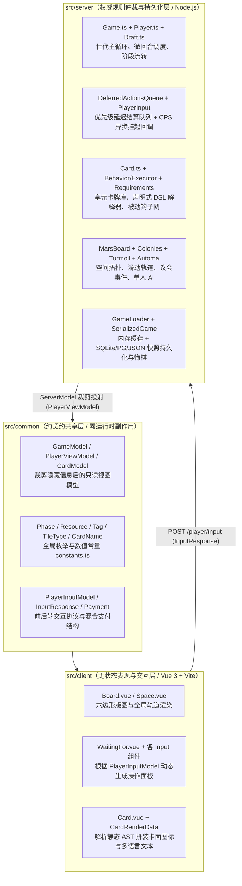
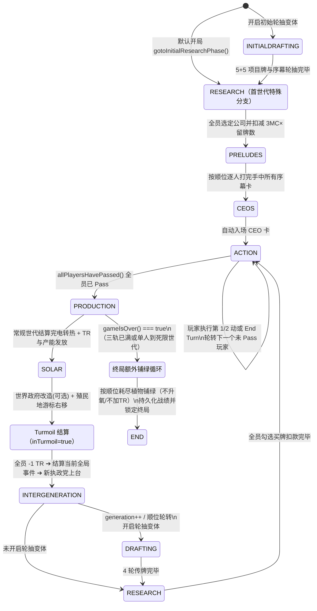
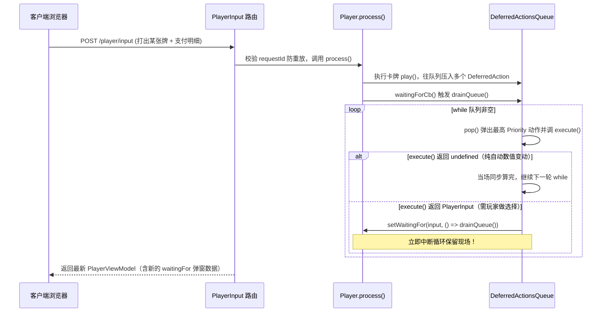

# 《殖民火星》（Terraforming Mars）开源仓库源码架构与玩法机制实现拆解

> **文档定位**：本文档与同目录下的《[殖民火星_玩法全盘调研与机制拆解.md](./殖民火星_玩法全盘调研与机制拆解.md)》互为表里——前文聚焦**桌面规则、数值锚点与博弈生态**，本文聚焦本地克隆的社区权威开源实现（[`terraforming-mars/`](./terraforming-mars)）**在代码层面如何将上千张卡牌、嵌套触发器、六边形版图、混合货币支付与多扩展模块建模为一套高内聚、可回滚、防作弊的状态机引擎**，并在末章提炼出可直接复用于《白屋》（硬核模式）工程落地的架构范式与避坑指南。

---

## 一、 全局工程拓扑与三层解耦架构

整个代码库基于 TypeScript 全栈同构（Node.js 服务端 + Vue 3 前端），在 [`src/`](./terraforming-mars/src) 下严格划分为零循环依赖的三层结构：



### 核心工程铁律
1. **客户端零规则判定权**：[`src/client/`](./terraforming-mars/src/client) 不执行任何出牌合法性、资源扣减或摸牌洗牌逻辑；所有合法集合（如哪些手牌亮起可打、地图哪些六边形格可点、哪些支付资源可勾选）均由服务端提前算好并打包进 `PlayerInputModel` 下发。
2. **服务端视图防作弊裁剪（Projection）**：[`ServerModel.ts`](./terraforming-mars/src/server/models/ServerModel.ts) 中的 `Server.getPlayerModel(player)` 负责把内存中的完整 `Game` 投射为单名玩家视角的 `PlayerViewModel`：
   - 对手的手牌仅下发张数 `cardsInHandNbr: player.cardsInHand.length`，绝不下发具体卡名；
   - 牌库与弃牌堆仅下发剩余张数 `deckSize` / `discardPileSize`；
   - 对手的 `PlayerId`（在网页端相当于登录凭证 Token）在对局结束前被强制抹除（`id: game.phase === Phase.END ? player.id : undefined`），防止抓包冒充对手出牌。
3. **编译期与运行期内存分离**：卡面排版 DSL（[`CardRenderer.ts`](./terraforming-mars/src/server/cards/render/CardRenderer.ts)）仅在编译期脚本导出静态 `cards.json` 时构建完整 AST；线上服务端运行时检测到 `isLiveServer()` 直接返回单例空节点 `EMPTY_ROOT`，省去上千张卡牌渲染树的常驻内存开销。

---

## 二、 顶层世代状态机与微回合循环实现

规则书中的“4 大阶段”在源码 [`Phase.ts`](./terraforming-mars/src/common/Phase.ts) 与 [`Game.ts`](./terraforming-mars/src/server/Game.ts) 中被拆细为 **9 个显式 `Phase` 状态 + 1 个内嵌 `inTurmoil` 标记**，以精确处理首世代选公司/序幕、多人同步轮抽与终局额外铺绿。

### 1. 世代状态流转全景图



### 2. 三个关键阶段的源码级实现细节

#### （1）多人并发阶段的「同步屏障（Barrier）」模式
在轮抽（[`Draft.ts`](./terraforming-mars/src/server/Draft.ts)）与研发买牌（`RESEARCH`）阶段，所有玩家是**并行操作**而非串行轮流的，源码采用 `Set` 收集完成状态充当同步栅栏：
- **开局选公司栅栏**（`Game.playerHasPickedCorporationCard`）：每位玩家提交 `SelectInitialCards` 时，先暂存至 `player.pickedCorporationCard` 而不立即结算——直到 `players.every(p => p.pickedCorporationCard !== undefined)` 为真时，才按 `playersInGenerationOrder` 统一调用 `playCorporationCard()`，防止早提交的玩家提前暴露公司效果或改变公共牌库状态。
- **轮抽阶段「未齐允许反悔重选（Repick）」**（`Draft.onCardDrafted`）：当玩家 A 选好 1 张牌但玩家 B 仍在思考时，服务端会给玩家 A 重新挂载一个标记了 `optional: true`（不计思考用时）的 `askPlayerToDraft(player, repick = true)` 输入框，允许其在最后一人落定前随时更换刚才扣下的牌；一旦最后一人选完，立即批量 `clearWaitingFor()` 清掉所有人的重选框并按奇偶世代方向（`generation % 2 === 0 ? 'after' : 'before'`）移交手牌数组。

#### （2）微回合（1～2 动）与单挑收尾优化（`Player.takeAction()`）
行动阶段每次调度落到某名玩家头上时，`Game.startActionsForPlayer` 将 `player.actionsTakenThisRound` 归零，随后进入 [`Player.ts`](./terraforming-mars/src/server/Player.ts) 的自递归方法 `takeAction()`（第 1462～1571 行）：
1. **先排空队列**：首行强制包裹 `this.game.drainQueue(() => { ... })`，确保上一动遗留的所有连锁选择彻底结算干净，再保存存档点 `game.save()`。
2. **回合切换判定**：
   ```ts
   if (game.hasPassedThisActionPhase(this) ||
      (this.allOtherPlayersHavePassed() === false && this.actionsTakenThisRound >= this.availableActionsThisRound)) {
     this.actionsTakenThisRound = 0;
     this.availableActionsThisRound = 2;
     game.playerIsFinishedTakingActions();
     return;
   }
   ```
   - 常规情况下 `availableActionsThisRound = 2`（特定卡牌如 `Mars Maths` 可临时改为 3 动）。
   - **第 1 动特权**：当 `actionsTakenThisRound === 0` 时，生成的动作菜单 `getActions()` **不提供 `End Turn`（仅提供彻底退出的 `Pass`）**；当 `actionsTakenThisRound === 1` 时，解锁 `End Turn`（执行后直接令 `actionsTakenThisRound = availableActionsThisRound` 从而交出本小轮控制权，但下一圈仍可行动）以及 `Undo`（悔棋）。
   - **体验优化细节**：注意 `this.allOtherPlayersHavePassed() === false` 条件——当场上其余玩家全部宣布本世代 `Pass` 后，仅剩的最后一名活跃玩家将**自动解除每轮 2 动的切片限制**，可以一口气把当世代所有剩余操作连点打完，省去无意义的“每 2 动点一次确认”。

#### （3）生产阶段与终局铺绿分流（`Player.runProductionPhase` & `Game.postProductionPhase`）
- **状态清扫**：清空本世代已用蓝卡集合 `actionsThisGeneration.clear()`、本世代已点标准项目集合 `standardProjectsThisGeneration.clear()` 及政党技能计数。
- **电转热与钩子拦截**：默认直接执行 `this.heat += this.energy; this.energy = 0;`，但若玩家场上有《超级电容器（Supercapacitors）》，则挂起一个延迟选择让玩家决定保留多少电力不转热能，选完再回调 `finishProductionPhase()` 发放 `TR + 各产能`。
- **终局最后铺绿（`takeNextFinalGreeneryAction`）**：生产阶段队列排空后，若 `gameIsOver()` 成立，不会直接跳 `END`，而是按本世代顺位轮询 `canPlaceGreenery(player)`（手握至少 8 植物且版图有空地），调用 `addGreenery(this, space, shouldRaiseOxygen = false)`——只放置绿地拿版图即时返利和终局版图分，**严格禁止再触发升氧与涨 TR**。

---

## 三、 核心工程引擎：无协程状态机如何驱动「多层嵌套连锁结算」

桌游代码化最棘手的问题在于：**单个动作中间可能夹杂任意多层、跨多名玩家的异步交互选择**。  
例如：玩家打出一张牌铺设绿地 ➔ 氧气升至 `8%` 奖励升温 1 格 ➔ 温度恰好升至 `0°C` 奖励免费铺设 1 块海洋（**需玩家选六边形格**）➔ 所选海洋格印有“摸 2 张牌”且贴着对手的《菲拉雷斯（Philares）》板块（**需对手选 1 种标准资源**）➔ 摸牌后若之前触发了《火星大学》科学标，还要询问（**需玩家选弃哪张手牌换抽牌**）。

在基于 HTTP 请求-响应模型的 Web 服务端（或单线程 UI 事件循环）中，不能在函数栈中途阻塞等待网络包。本仓库用 **「`PlayerInput` 延续传递（CPS） + `DeferredActionsQueue` 最小堆优先级队列」** 完美拆解了这一难题。

### 1. 交互原语：`PlayerInput`（[`src/server/PlayerInput.ts`](./terraforming-mars/src/server/PlayerInput.ts)）
每一种需要人类做决定的弹窗被抽象为一个 `BasePlayerInput<T>` 子类（共 20 余种，位于 [`src/server/inputs/`](./terraforming-mars/src/server/inputs)）：
- **结构组合器**：`OrOptions`（多选一单选菜单树，如玩家主回合的 7～10 类大动作入口）、`AndOptions`（多步骤同屏打包提交，如殖民地贸易同时选“用什么付路费”和“去哪个殖民地”）；
- **领域选择器**：`SelectProjectCardToPlay`（选打哪张手牌并附带混合支付明细）、`SelectCard`（从候选牌列表选 `min..max` 张）、`SelectSpace`（传入合法 `Space[]` 高亮版图格点选）、`SelectPayment`（滑块分配钢/钛/热/MC）、`SelectPlayer`、`SelectResource`、`SelectAmount` 等。
- **`.andThen(cb)` 延续绑定**：创建输入对象时把“拿到玩家选择 `param: T` 之后要干什么”注册进 `this.cb`；当客户端发回 JSON 响应时，`player.process(inputResponse)` 校验参数合法性并调用 `cb(parsedValue)`。

### 2. 调度中枢：`DeferredActionsQueue` 与 25 级 `Priority` 偏序
所有可能产生交互或需要严格规定先后次序的子效果，统统不直接阻塞调用栈，而是封装成 `IDeferredAction` 通过 `game.defer(action, priority)` 推入最小堆 [`DeferredActionsQueue.ts`](./terraforming-mars/src/server/deferredActions/DeferredActionsQueue.ts)：



### 3. `Priority` 优先级枚举背后的规则时序智慧
打开 [`Priority.ts`](./terraforming-mars/src/server/deferredActions/Priority.ts) 可以看到历经数千个 Issue 打磨出的 **25 级结算优先级**（数值越小越先执行），堪称卡牌电子化的教科书：

| 优先级顺位（从高到低） | 枚举名 | 为什么要排在这个位置？（防 Bug 原理） |
| :---: | :--- | :--- |
| **1** | `DECLARE_CLONE_TAG` | 打出带克隆标的牌时，必须在一切联动触发前先选定它变成什么标签 |
| **2** | `COST` | 蓝卡行动支付或红党升 TR 税——**必须先扣完钱，再去触发后续收益**，绝不允许拿后续摸到的资源倒回来付当前动作的账 |
| **3** | `MAYBE_BLOCK_ATTACK` | 地下世界扩展花腐败值格挡攻击——必须在扣血前询问受害者挡不挡 |
| **4～5** | `PHARMACY_UNION` | 药业联盟微生物/科学联动改变 TR 与手牌费用，需早于常规触发 |
| **6～7** | `BEFORE_OPPONENT_TRIGGER` ➔ `OPPONENT_TRIGGER` | 当前回合主动玩家的抉择优先于对手卡牌的被动响应（符合桌游主客顺位规则） |
| **8～10** | `OLYMPUS_CONFERENCE` ➔ `SPONSORED_ACADEMIES` | 同样由科学标触发时：先往奥林匹斯会议叠科学标（或拿标换摸牌），再结算学院弃牌全桌摸牌 |
| **11** | `DRAW_CARDS` | **直接摸牌永远排在“弃一摸一”之前**——先拿完牌面白送的牌扩充手牌池，再决定拿哪张废牌喂给火星大学滤掉！ |
| **12～14** | `BUILD_COLONY` / `PLACE_OCEAN_TILE` | 版图铺海与建殖民地可能还会衍生出新一轮版图格摸牌或返现 |
| **15** | `DEFAULT` | 绝大多数常规卡牌行为的默认槽位 |
| **16** | `DISCARD_AND_DRAW` | 《火星大学》等“可弃 1 张手牌摸 1 张牌”在此刻结算，此时本动作送的牌已全部到手 |
| **17～19** | `ATTACK_OPPONENT` ➔ `GAIN_...` ➔ `LOSE_...` | 攻击对手、增减产能与库存的收尾结算 |
| **20** | `DECREASE_COLONY_TRACK_AFTER_TRADE` | **极其关键**：殖民地贸易发完主奖励与全员常驻奖励后，最后一步才把轨道游标重置回左端保底格！ |
| **23** | `BACK_OF_THE_LINE` | 恢复 `temporarySolarPhase` 临时阶段等全局善后钩子 |

> [!TIP]
> **多玩家同时弹窗特例（[`GiveColonyBonus.ts`](./terraforming-mars/src/server/deferredActions/GiveColonyBonus.ts)）**：  
> `DeferredActionsQueue` 默认每次只挂起 1 名玩家的 `waitingFor`。但当某玩家去冥王星（Pluto）贸易，而场上 3 名玩家都在冥王星建有殖民地（每人被动触发“摸 1 张弃 1 张”）时，若串行等待 3 人依次弃牌会严重拖慢网战节奏。`GiveColonyBonus` 特意绕开单人阻塞，用 `MultiSet<PlayerId>` 记录所有待领奖玩家，一次性给所有涉及玩家**并行挂载各自的 `setWaitingFor`**，每有一人点完就递减计数，直到 `playersWithBonuses.size === 0` 时才统一触发主队列回调继续往下走。

---

## 四、 资源、产能、标签计数与复合货币支付求解器

### 1. 库存 `Stock` 与产能 `Production`：严格区分 `spend` 与 `lose`
在 [`Stock.ts`](./terraforming-mars/src/server/player/Stock.ts)、[`Production.ts`](./terraforming-mars/src/server/player/Production.ts) 与 [`Behavior.ts`](./terraforming-mars/src/server/behavior/Behavior.ts) 中，源码把“减少资源/产能”拆成了两条语义截然不同的通道：
1. **主动支出成本（`spend` / `deductUnits`）**：属于“等价交换的前提条件”。出牌前由 `canPlay` / `canAct` 严格拦截（例如产能扣减不得跌破 `PRODUCTION_MINIMUMS`：MC 最低 `-5`，其余五门最低 `0`；库存必须足额）。若代码 Bug 导致库存不足仍强行扣减，`Stock.add` 会拒绝扣成负数并调用 `game.logIllegalState` 报警。
2. **非阻断式损耗与受击（`lose` / `player.attack`）**：用于红卡陨石砸植物、全局天灾扣钱或自身妥协副作用。源码通过 `loseable()` 函数（`Executor.ts` 第 52 行）将扣减量宽容截断在 `[0, 当前值 - 下限]` 区间内——**哪怕玩家当前只有 2 棵植物，对手依然能合法打出“移除目标至多 8 棵植物”的陨石卡**；且一旦 `from` 指向其他玩家（`isFromPlayer(from)`），底层自动触发《诉讼（LawSuit）》仇恨标记与《孟斯保险（Mons Insurance）》自动赔付钩子。

### 2. 复合货币支付与「预留资源锁」求解器（`Player.canAffordInternal`）
《殖民火星》支持多达 **13 种混合支付源**（[`Payment.ts`](./terraforming-mars/src/common/inputs/Payment.ts)：`MC`、建筑牌用`钢`、太空牌用`钛`、Helion 公司用`热能`、植物牌用《嗜冷菌》上的`微生物`、金星牌用`浮空器`、月球/探路者扩展用`科学/数据/种子/石墨烯`等），且部分折价券不可找零。

为了在毫秒级判断玩家手牌里 20 张牌哪些能打亮起、哪些灰掉，[`Player.ts`](./terraforming-mars/src/server/Player.ts)（第 1321～1427 行）设计了 **`reserveUnits`（硬性预留锁）+ `redsCost`（动态税费）两段式校验算法**：
1. **提取硬性保留库存（`reserveUnits`）**：假设某张太空牌费用 `12 MC`，同时卡面效果要求“消耗自身 2 点钛金属库存”；若玩家手头只有 `6 MC + 2 钛（值 6 MC）`，表面总购买力虽然等于 `12 MC`，但一旦拿这 2 钛去抵扣牌费，结算卡面时就没钛可扣了！因此 `maxSpendable(reserveUnits)` 第一步先从玩家真实库存里硬性锁死 `reserveUnits`（2 钛不可用于抵牌费），若连 `reserveUnits` 都不够直接判 `false`。
2. **单独核算不可用折价券支付的附加税（`redsCost`）**：当动荡扩展“红党（Reds）”执政时，卡牌每预期提升 1 点 TR（通过 `BehaviorExecutor.toTRSource` 静态预估），玩家必须额外支付 `3 MC` 纯现金（不能用钢钛抵扣！）。算法先用纯通货购买力 `payingAmount(maxPayable, {})` 校验够不够交红党税。
3. **汇总定向折价券总购买力**：最后按当前卡牌的标签激活可用折价券开关（`paymentOptionsForCard`），乘上玩家当前的动态汇率（`getSteelValue()` / `getTitaniumValue()`，兼容《高级合金》+1 汇率光环），判断 `options.cost + redsCost <= usable`。
4. **防自杀特判**（第 785～800 行）：如《平流层鸟类》要求“消耗任意卡上 1 个浮空器”且自身带金星标可用《飞艇》上的浮空器付牌费——若玩家把场上唯一来源的浮空器全拿去抵了牌费，结算将卡死，源码专门在 `checkPaymentAndPlayCard` 拦截此类边界耗尽行为。

### 3. 双桶标签缓存与 6 模态标签统计（`PlayedCards.ts` & `Tags.ts`）
玩家场上的卡牌集合并未简单使用原生数组，而是封装为 [`PlayedCards.ts`](./terraforming-mars/src/server/cards/PlayedCards.ts)：
- 内部同时维护按打出顺序排列的 `array`、`byName: Map<CardName, ICard>`（将全场高频调用的 `player.tableau.has(CardName.XXX)` 从 $O(N)$ 降为 **$O(1)$**），以及两个实时增减的标签计数桶：
  - `_tags: Record<Tag, number>`：在压入绿卡、蓝卡、公司卡、序幕卡时累加其标签；
  - `_eventTags: Record<Tag, number>`：当压入 `card.type === CardType.EVENT`（红卡）时，**单独记入 `_eventTags` 而不污染 `_tags`**！
- 在此之上，[`Tags.ts`](./terraforming-mars/src/server/player/Tags.ts) 通过 `CountingMode` 干净处理了所有规则特例：
  - `'default'`（行动阶段校验打牌门槛、计算卡牌缩放收益）：自动加上玩家场上的百搭标 `Tag.WILD` 以及《地球大使馆》（月球标算地球标）、《火星栖息地》（火星标算科学标）等转换光环；
  - `'raw'`（终局计算木星乘区 VP、结算动荡全局事件、统计对手标签数）：**严格只读牌面原始标签，屏蔽一切百搭标 `WILD`**，精准还原官方规则“百搭标只在行动阶段生效”。

---

## 五、 卡牌系统四层架构：牌堆隔离、条件编译器、声明式 `Behavior DSL` 与钩子网

全仓库共实现约 **1,000+ 张卡牌**（横跨 16 个官方与社区模块），如果每张牌都手写几百行过程式 `if/else`，维护与测试将彻底失控。源码通过四层抽象把单卡平均代码量压缩到了 **25～45 行**。

### 1. 牌堆构建与「红卡绝不进公共弃牌堆」的物理隔离
- **确定性牌堆组装（[`GameCards.ts`](./terraforming-mars/src/server/GameCards.ts)）**：每个扩展包拥有一份静态注册清单 `ModuleManifest`（分别列出 `projectCards`、`corporationCards`、`preludeCards`、`ceoCards`、`standardProjects` 以及需替换移除的旧版同名卡 `cardsToRemove` 和跨扩展依赖 `compatibility`）。开局按固定常量数组 `DECK_MODULE_ORDER` 排序实例化后，交由带种子的随机数发生器 `SeededRandom` 洗入四套独立 [`Deck.ts`](./terraforming-mars/src/server/cards/Deck.ts) 实例。
- **弃牌堆隔离实现**：
  - 当玩家**打出**任何手牌（无论是绿卡、蓝卡还是**一次性事件红卡**）时，`Player.playCard()` 将其从 `cardsInHand` 移除后**统一推入玩家个人的 `this.playedCards`**，绝不调用 `projectDeck.discard()`！
  - 只有以下场景才会进入公共弃牌堆 `projectDeck.discardPile`：① 开局/研发阶段摸出但没花 3 MC 买下的牌；② 标准项目“出售专利”卖掉的手牌；③ 《火星大学》等滤牌效果从手牌弃置的牌；④ 探索牌翻牌堆顶不符合指定标签被弃掉的牌。
  - 当 `projectDeck.drawPile` 被摸空时，`Deck.shuffleIfNecessary()` 仅将 `discardPile` 洗回 `drawPile`。这既保证了已打出的事件红卡绝不会被重洗回牌库二次打出，又让红卡安静留在玩家的 `playedCards` 里参与终局正负 VP 结算与“已打出事件数”统计。

> [!WARNING]
> **源码作者亲笔留下的「卡牌入场时序」血泪教训（[`Player.ts`](./terraforming-mars/src/server/Player.ts#L891-L906)）**：  
> 在 `Player.playCard()` 第 905 行，历史代码先调用了 `selectedCard.play(this)`，直到第 923 行才执行 `this.playedCards.push(selectedCard)`。  
> 这导致一个深远的连锁副作用：所有规则写着“每拥有 1 个地球/植物/科学标签（含本卡）获得 X”的卡牌，在执行 `play()` 那一刻**它自己居然还不在 `playedCards` 里**！迫使整个代码库不得不在 [`Counter.ts`](./terraforming-mars/src/server/behavior/Counter.ts#L49-L53) 里专门维护一个 `this.cardIsUnplayed = !player.tableau.has(card.name)` 脏补丁去手动 `+1`，甚至在遇到复制序幕卡（`Double Down`）时引发连环特判。作者在注释中明确写道：*“IMPORTANT: This is the wrong place to take the play card action. It should be played after putting the card into the playedCards array.”* —— **自研新卡牌引擎时务必引以为戒：先移动卡牌归属状态入场，再触发 `play` 与 `onCardPlayed`！**

### 2. 静态享元缓存（[`Card.ts`](./terraforming-mars/src/server/cards/Card.ts) Flyweight Pattern）
每张卡牌子类在 `super({ ... })` 中传入静态配置对象 `StaticCardProperties`。`Card` 基类构造函数内部维护了一个全局静态字典：
```ts
const cardProperties = new Map<CardName, InternalProperties>();
```
无论服务器上同时运行多少局游戏、实例化了多少次《藻类（Algae）》，其费用、标签、预编译好的前置条件对象与渲染元数据只在内存中存**唯一一份**；每个 `Card` 实例自身只携带 3 个极轻量的动态字段：`resourceCount = 0`（卡面叠放的微生物/动物数）、`warnings = NO_WARNINGS`（共享空集合引用）与可选的 `data` JSON。

### 3. 双向前置条件编译器（[`CardRequirements.ts`](./terraforming-mars/src/server/cards/requirements/CardRequirements.ts)）
卡牌配置只需写声明式字面量（如 `requirements: { oceans: 5 }` 或 `{ temperature: -18, max: true }` 或 `[{ tag: Tag.SCIENCE, count: 2 }]`），`Card.internalize()` 会在首次加载时将其预编译为 `CardRequirement` 校验器数组。  
在 [`GlobalParameterRequirement.ts`](./terraforming-mars/src/server/cards/requirements/GlobalParameterRequirement.ts) 中，处理“全局参数 ±2 格放宽光环”（如《适应性技术》、科学党执政政策）的公式极为优雅：
```ts
public getScore(player: IPlayer): number {
  const bonus = player.getGlobalParameterRequirementBonus(this.parameter) * this.scale; // 温度每格 scale=2，其余为 1
  const level = this.getGlobalValue(player);
  return this.max ? (level - bonus) : (level + bonus);
}
```
下限要求（`level + bonus >= count`）与上限要求（`level - bonus <= count`）通过一个正负号翻转即可统一处理所有双向锁放宽！

### 4. 声明式效果 DSL（`Behavior` + `Executor` + `Counter`）
这是该仓库近年重构最精华的设计——约 70% 以上的项目卡、公司首动与蓝卡重复行动不再手写 `play()` / `action()` 方法，而是直接声明一个纯数据结构 [`Behavior`](./terraforming-mars/src/server/behavior/Behavior.ts)。  
以 [`Algae.ts`](./terraforming-mars/src/server/cards/base/Algae.ts) 为例，整张牌仅需 20 行纯声明配置：
```ts
export class Algae extends Card implements IProjectCard {
  constructor() {
    super({
      type: CardType.AUTOMATED,
      name: CardName.ALGAE,
      tags: [Tag.PLANT],
      cost: 10,
      behavior: {
        production: {plants: 2},
        stock: {plants: 1},
      },
      requirements: {oceans: 5},
      metadata: {
        cardNumber: '047',
        description: 'Requires 5 ocean tiles. Gain 1 plant and increase your plant production 2 steps.',
        renderData: CardRenderer.builder((b) => b.production((pb) => pb.plants(2)).plants(1)),
      },
    });
  }
}
```

**同一份 `Behavior` 数据被 [`Executor.ts`](./terraforming-mars/src/server/behavior/Executor.ts) 一鱼三吃**：
1. **事前合法性预判（`canExecute`）**：自动检查 `production` 变动会不会把某项产能扣穿下限、`spend` 够不够付、`city/greenery/tile` 在当前版图上还有没有合法空位可摆、`drawCard` 牌库够不够抽；若全局温度/氧气/海洋已满，自动给卡牌打上黄色提醒 `card.addWarning('maxtemp')`（允许玩家明知溢出仍强行打出，但在前端按钮上弹二次确认警告！）。
2. **事中效果执行（`execute`）**：自动通过 [`Counter.ts`](./terraforming-mars/src/server/behavior/Counter.ts) 计算动态缩放表达式（如 `stock: { megacredits: { tag: Tag.EARTH, each: 2, per: 1 } }` 或 `victoryPoints: { resourcesHere: {}, per: 2 }`），将确定性数值直接写入 `stock/production`，将需要选点/选牌/选目标的动作自动转化为对应的 `PlaceOceanTile`、`AddResourcesToCard`、`RemoveAnyPlants`、`OrOptions` 压入延迟队列。
3. **事后离场回滚（`onDiscard`）**：若卡牌提供 `steelValue: 1` / `greeneryDiscount: 1` 等常驻属性修改，当该卡被特殊效果弃置离场时，自动逆向还原玩家面板属性。
4. **逃生舱机制（`bespokeCanPlay` / `bespokePlay` / `ActionCard`）**：对于声明式 DSL 覆盖不到的 20% 复杂机制牌（如《火星大学》[`MarsUniversity.ts`](./terraforming-mars/src/server/cards/base/MarsUniversity.ts)、《病毒增强器》[`ViralEnhancers.ts`](./terraforming-mars/src/server/cards/base/ViralEnhancers.ts)），基类预留了模板钩子与 `ICard` 事件监听接口，不强行污染 DSL 语法复杂度。

### 5. 全生命周期被动光环与触发器接口（[`ICard.ts`](./terraforming-mars/src/server/cards/ICard.ts)）
蓝卡与公司卡的常驻联动通过 `ICard` 上的可选钩子挂载，由引擎在对应时机遍历 `playedCards` 触发：

| 触发时机分类 | `ICard` 钩子方法名 | 典型代表卡牌 / 用途 |
| :--- | :--- | :--- |
| **费用减免计算** | `cardDiscount` 属性 / `getCardDiscount(player, card)` | 《反重力技术》（全牌 -2）、《地球办公室》（地球标 -3） |
| **标准项目减费** | `getStandardProjectDiscount(player, project)` | 《标准技术》（点标准项目返现/减费） |
| **条件门槛放宽** | `globalParameterRequirementBonus` / `getGlobalParameterRequirementBonus` | 《适应性技术》《特种设计》（仅下一张牌 ±2） |
| **出牌事件响应** | `onCardPlayed(player, card)` / `onCardPlayedByAnyPlayer(...)` | 《火星大学》（打科学标滤牌）、《病毒增强器》（打生态标送植物/叠标）、《媒体集团》（打事件返 3 MC） |
| **版图落子响应** | `onTilePlaced(cardOwner, activePlayer, space, boardType)` | 《移民城市》（每当全场任意人建城，自身 +1 MC 产能）、《水培农场》 |
| **牌面叠标响应** | `onResourceAdded(player, targetCard, count)` | 《肉类工业》（每当己方获得动物标记，额外拿 2 MC） |
| **全局改造响应** | `onGlobalParameterIncrease` / `onIncreaseTerraformRatingByAnyPlayer` | 各类改造联动公司与蓝卡 |
| **世代生产钩子** | `onProductionGain` / `onProductionPhase(player)` | 《机器人劳工》复制产能盒、生产阶段额外结算 |

---

## 六、 六边形版图拓扑、全局轨道跨轴连锁与终局计分器

### 1. 六边形网格的偏移坐标与空间约束（[`Board.ts`](./terraforming-mars/src/server/boards/Board.ts) & [`MarsBoard.ts`](./terraforming-mars/src/server/boards/MarsBoard.ts)）
标准火星版图共 9 行（偶数行与奇数行交错缩进，外加若干不与任何陆地相邻的场外太空城格 `SpaceType.COLONY`，如卫城火卫一）。
- **邻接表预计算（`Board.computeAdjacentSpaces`）**：构造版图时按 `middleRow = maxY / 2`（赤道第 4 行）分上、中、下三个象限修正左上/右上/左下/右下的 `x` 偏移量，按从左上起顺时针顺序 `0..5` 生成每个格子的邻居列表并永久缓存在 `adjacentSpaces: Map<SpaceId, ReadonlyArray<Space>>` 中，后续所有邻格查询均为 $O(1)$。
- **三大精妙的空间合法性过滤器**：
  1. **绿地强制贴己方板块法则（`MarsBoard.getAvailableSpacesForGreenery`）**：先筛出全图合法陆地空位，再在其中过滤出“至少与 1 块己方已拥有的实体板块相邻”的子集 `spacesForGreenery`——**若该子集非空，玩家只能点选该子集；仅当玩家在版图上没有任何相邻空位（或尚未落过子）时，才回退开放全图空位**。
  2. **0 电产造城的「落地回能自洽」预判（`MarsBoard.filterForEnergy`）**：许多建城卡要求 `-1 电力产能`，常规情况下 0 电产玩家禁止打出；但若某地图（如极乐世界或自定义图）上有空位本身印着 `+1 电力产能` 的版图奖励，源码允许 0 电产玩家打出该建城卡，并在选点时强制将可选格过滤为带有 `SpaceBonus.ENERGY_PRODUCTION` 的格子！
  3. **付费型版图奖励防卡死（`MarsBoard.canAffordPlacementBonuses`）**：赫拉斯（Hellas）南极格印有“花 6 MC 铺 1 块海洋”的绑定奖励——若玩家打完牌剩余不足 6 MC，该格子会在可选列表中直接被剔除，避免玩家踩上去后付不起强制绑定费导致队列死锁。

### 2. 全局参数跨轴连锁与 `Phase.SOLAR` 隔离锁（[`GlobalParameterTracks.ts`](./terraforming-mars/src/server/boards/GlobalParameterTracks.ts)）
每张地图将温度轨、氧气轨、金星轨的节点红利配置为阈值数组 `GlobalParameterThreshold[]`：
- 当某参数从 `from` 升至 `to` 时，`grantGlobalParameterTrackBonuses` 遍历所有满足 `from < value && to >= value` 的阈值（即使一张大牌连升 3 格跨过两个红利点也不会漏发）；
- 当氧气跨过 `8%` 时，直接同步调用 `player.game.increaseTemperature(player, 1)`，若此时温度正好从 `-2°C` 跨上 `0°C`，`increaseTemperature` 内部会再次触发阈值检查并压入 `new PlaceOceanTile(player)`，一气呵成完成“铺绿 ➔ 升氧 ➔ 升温 ➔ 免费铺海”四连跳；
- **世界政府（WGT）无收益锁**：当处于 `Phase.SOLAR`（或殖民地/卡牌通过 `game.temporarySolarPhase` 模拟世界政府推进全局进度）时，源码通过 `if (this.phase !== Phase.SOLAR)` 精准屏蔽玩家的 `+TR`、个人产能提升与摸牌红利，仅保留物理轨道本身的推进与海洋/升温连锁。

### 3. 里程碑/奖项的「协同度约束随机算法」与并列计分
- **防单一流派垄断抽样（[`MilestoneAwardSelector.ts`](./terraforming-mars/src/server/ma/MilestoneAwardSelector.ts)）**：开启随机里程碑与奖项时，如果纯随机盲抽，极易抽出高度同质化的组合（例如里程碑抽到“建筑师[8建筑标] + 园丁[3绿地]”，奖项又抽到“承包商[最多建筑标] + 耕耘者[最多绿地]”），导致拿到对应起手的玩家顺手通吃 20+ VP。源码在 `MilestoneAwardSynergies.ts` 中为所有里程碑和奖项两两标定了协同度分值（`0～9`），随机抽取器 `Accumulator` 在每抽入一个候选者时实时核验 `LIMITED_SYNERGY` 三条硬约束：**任一对最高协同度 ≤ 6、全套 10 项两两协同度总和 ≤ 20、高协同对数受限**；若撞墙则丢弃重抽（10 万次蒙特卡洛测试验证 3 次以内必收敛）。
- **终局计分器与奖项并列规则（[`calculateVictoryPoints.ts`](./terraforming-mars/src/server/game/calculateVictoryPoints.ts)）**：
  - 汇总 `TR` + `里程碑(5 VP/个)` + `奖项` + `版图绿地(1 VP/块)` + `版图城市(周围每块任意玩家的绿地 +1 VP)` + `已打出卡牌 VP（含事件卡正负分）`；
  - 奖项排名算法（`giveAwards`）：按 `AwardScorer` 降序排列后，若多人并列第一名，所有并列第一名均拿满 `5 VP`，且**直接吃掉第二名名额（不再发放 `2 VP`）**；仅当第一名唯一且总人数 > 2 时，才向第二名（含所有并列第二名）发放 `2 VP`。

---

## 七、 外围滑动轨道（Colonies）、周期性全局高压（Turmoil）与单人 AI（MarsBot）

### 1. 殖民地滑动轨道状态机（[`Colony.ts`](./terraforming-mars/src/server/colonies/Colony.ts) & [`player/Colonies.ts`](./terraforming-mars/src/server/player/Colonies.ts)）
这一模块正是《白屋》硬核模式外围 **【话事人】与【特殊地点】** 的直接工程原型，其底层数据模型极度精炼，每块面板仅需 **4 个状态变量**：
- `isActive: boolean`：面板是否激活入场（例如含动物/微生物奖励的殖民地，在全场有人打出首张对应资源卡前处于休眠锁死态，由 `ColoniesHandler.maybeActivateColonies` 动态唤醒）；
- `colonies: Array<PlayerId>`：已建立常驻席位的玩家 ID 数组（上限 `MAX_COLONIES_PER_TILE = 3`）；
- `trackPosition: number`：当前滑动轨道游标位置（`0..6`）；
- `visitor: PlayerId | undefined`：本世代是否已被访问的互斥锁（非空即代表当天已接待过访客，其余人不可再选）。

**四大操作闭环源码映射**：
1. **建立常驻席位（`addColony`）**：发放 `metadata.build` 落座即时奖励 ➔ `this.colonies.push(player.id)` ➔ 若当前 `trackPosition < this.colonies.length`，立即将游标垫高至 `this.colonies.length`。
2. **执行单次访问/贸易（`trade` ➔ `handleTrade`）**：
   - 先用策略模式 `IColonyTrader`（[`player/Colonies.ts`](./terraforming-mars/src/server/player/Colonies.ts) 第 59～102 行的 `TradeWithEnergy` / `TradeWithTitanium` / `TradeWithMegacredits` / 卡牌特殊付费器）让玩家任选一种合法路费支付；
   - 计算玩家自带的推格加成 `tradeOffset`，发放 `metadata.trade.quantity[this.trackPosition]` 主轨道收益；
   - 压入 `GiveColonyBonus` 向 `this.colonies` 数组里的所有常驻玩家发放一份 `metadata.colony` 常驻被动收益；
   - 锁死当日互斥位 `this.visitor = player.id`，并消耗玩家当日总出行次数额度 `player.colonies.usedTradeFleets++`（受限于 `fleetSize`，默认 1，仅特定高阶卡可调用 `increaseFleetSize()` 扩充上限）；
   - 最后以 `Priority.DECREASE_COLONY_TRACK_AFTER_TRADE` 优先级执行 `this.trackPosition = this.colonies.length`——**巧妙地用“常驻席位数组长度”直接充当游标回退的保底格下标**！
3. **世代末自动涨格与解锁（`endGeneration`）**：所有活跃殖民地统一执行 `increaseTrack(1)`（游标右移一格，封顶 6），同时令 `this.visitor = undefined`、玩家 `usedTradeFleets = 0` 重新开放次日争夺。

### 2. 提前两世代明牌预警的全局事件流水线（[`Turmoil.ts`](./terraforming-mars/src/server/turmoil/Turmoil.ts)）
动荡扩展将周期性环境冲击建模为一条三槽位移位寄存器：
`distantGlobalEvent`（远期翻开预告） ➔ `comingGlobalEvent`（下世代即将降临） ➔ `currentGlobalEvent`（本世代末结算）。  
玩家永远提前整整两个世代看清即将到来的全局奖惩条件，从容调整产能与库存结构；而在结算全局事件时，源码通过 `ProxyCard(CardName.GLOBAL_EVENT_PROXY)` 伪造一张代理卡喂给同一个 `BehaviorExecutor`，零重复代码复用了整套卡牌增减资源算法。

### 3. 零搜索树开销的单人虚拟对手（[`src/server/automa/`](./terraforming-mars/src/server/automa)）
在 1,000 张卡牌、隐藏信息与巨量分支因子下编写传统博弈树（MCTS / Minimax）AI 既慢又难维护。仓库的官方单人 Automa（`MarsBot`）展示了极具性价比的工程解法：
- **架构解耦**：`marsBotPlayer` 不放进 `game.players`（从而完全绕开正常人类玩家的轮抽、买牌、微回合等待循环），而是拼入 `game.playersPlusMarsBot`，使其依然能像真人一样在中央版图上占格铺城铺绿、抢走里程碑、参与终局奖项排名比大小！
- **确定性规则驱动**：机器人每个世代翻开公共牌堆顶的项目牌，读取牌面标签推动对应的机器人进度轨（满格即自动在地图最优格铺绿/铺城/升全局轨/抢里程碑）；遇到多个平局候选格时，调用 [`MarsBotCardFlip.ts`](./terraforming-mars/src/server/automa/MarsBotCardFlip.ts) 再翻一张牌按 `((card.cost - 1) % n + n) % n` 确定性选点——零算力消耗却能持续给单人玩家制造激烈的版图卡位、里程碑抢夺与终局关门压力。

---

## 八、 快照式「零逆向代码悔棋（Undo）」与程序化卡面渲染

### 1. 纯 JSON 快照与 `lastSaveId - 2` 无损悔棋（[`routes/PlayerInput.ts`](./terraforming-mars/src/server/routes/PlayerInput.ts) & [`GameLoader.ts`](./terraforming-mars/src/server/database/GameLoader.ts)）
在拥有上千张联动卡牌的游戏里，如果采用命令模式（Command Pattern）为每张牌编写 `undo()` 逆向回滚函数，一旦涉及摸牌洗牌、连锁铺海、被动触发器，逆向逻辑极易漏改状态引发灾难性 Bug。  
本仓库采用了极其干脆的**“稳定边界全量快照回滚”**方案：
1. **只在延迟队列为空的稳定点存盘**：[`SerializedGame`](./terraforming-mars/src/server/SerializedGame.ts) 中 `deferredActions` 恒为空数组——因为 `game.save()` 只在每个阶段起点或 `Player.takeAction()` 排空队列后才调用，每次存盘将整棵游戏树序列化为纯 JSON 写入数据库并将 `lastSaveId` 自增 1。
2. **伪随机数状态同步序列化**：`rng: this.rng.serialize()` 把线性同余/确定性随机数发生器的内部当前游标 `currentSeed` 一并存入快照！
3. **一键时光倒流**：当玩家做完第 1 动后悔点击 `UndoActionOption` 时，`PlayerInput.performUndo` 直接执行 `ctx.gameLoader.restoreGameAt(gameId, lastSaveId - 2)`，删掉最近两步增量存档，从上一动作前的干净 JSON 快照直接反序列化重建整个 `Game` 实例并令 `undoCount++`。不仅代码量不到 30 行、100% 绝对无残留状态污染，而且因为 `rng` 种子游标也一并回退，玩家就算悔棋重打同一张摸牌卡，摸上来的依然是完全相同的牌，彻底封死“借悔棋刷牌序（Save Scumming）”的漏洞！

### 2. 防连点重放的请求令牌锁（`validateRequestId`）
每次服务端调用 `player.setWaitingFor(input)` 生成新问题时，都会刷新一个随机的 `player.requestId` 下发给前端；前端提交答案时必须原样带回该 `requestId`（[`routes/PlayerInput.ts`](./terraforming-mars/src/server/routes/PlayerInput.ts#L150-L157)）。若玩家网络卡顿双击提交、或多开浏览器标签页用过期界面发包，会立即被 `INVALID_REQUEST_ID` 拦截并提示刷新，杜绝一动扣两次钱的并发事故。

---

## 九、 面向《白屋》（硬核模式）工程落地的十大架构借鉴与避坑指南

对照《[白屋总纲（系统策划）.md](../白屋总纲（系统策划）.md)》中的硬核模式设计，《殖民火星》这套经过数百万局实战检验的源码为我们提供了现成的工程蓝图与前车之鉴：

| 序号 | 《白屋》硬核模式核心机制 | 可直接复用的《殖民火星》源码范式与针对性改良建议 |
| :---: | :--- | :--- |
| **1** | **卡牌打出与【真相】/【事件】标志结算** | **【必避大坑】修正入场时序**：切勿照搬 `Player.playCard` 先调 `play()` 后入场的旧顺序！在《白屋》引擎中，扣完费用后应**先把绿/蓝牌移入玩家常驻区（或把红牌移入个人「已结算事件区」），再结算卡牌效果与触发器**，让“统计当前【真相】标志数”天然包含刚拍下的这张牌，零脏补丁。 |
| **2** | **【荒废木屋】弃牌堆 n 选一 vs 红牌隔离** | **直接复用 `Deck.discardPile` + `Player.playedCards` 双轨物理隔离**：未买的晨间候选牌、【舍弃】标准行动弃牌、【叶老师】摸一弃一弃牌、【荒废木屋】看牌顶不买弃牌统一进公共 `discardPile`；已打出的红牌（事件牌）存放在玩家个人的 `playedEvents` 数组（终局照常遍历算正负【因果力】），从数据结构根源杜绝【荒废木屋】把强力红牌捞回重打。 |
| **3** | **连锁异步抉择（如【叶老师】摸一弃一、点亮地图拿【收获】等）** | **引入精简版 `PlayerInput` + `DeferredActionsQueue`**：哪怕做纯单机客户端（Unity / Godot / Web 前端），也强烈建议将引擎逻辑写成纯数据驱动的 `DeferredAction` 优先级队列，与 UI 动画/弹窗解耦。设定清晰优先级：`支付成本` ➔ `主效果数值与推条` ➔ `直接摸牌` ➔ `叶老师摸一弃一 / 滤牌` ➔ `话事人游标归位`。 |
| **4** | **外围 7 块面板（5 位【话事人】+ 2 处【特殊地点】）** | **直接复用 `Colony` 四字段状态机 + `IColonyTrader` 付费策略模式**：底层统一用 `AutonomyPanel` 类（含 `seats: PlayerId[]`、`cursorIndex`、`visitedToday: boolean`），界面按 `category: 'person' \| 'place'` 分别渲染“交谈/打好关系”与“前往/熟悉环境”文案。对【话事人】挂载两个 `Trader`：`SpendOpportunityTrader`（通用花【机会】）与 `SpendTrustTrader`（要求 `seats.includes(player.id)`，花【信任度】吸引上门，但同样执行 `player.autonomyUsedToday++` 卡死单日总次数上限）。 |
| **5** | **【体力】+【异能】(1:2) +【信任度】(1:3) 混合支付与越权扣【理智】** | **复用 `canAffordInternal` 的 `reserveUnits` 预留锁架构**：把卡牌自带的硬性消耗（如主动扣【理智】、扣【异能】库存）及强行越权点亮中环/中枢节点的【理智】惩罚放进 `reserveUnits` 优先校验锁定，再将手头可用【异能】（带【异能】标时激活，乘动态汇率 `2 + 蓝牌加成`）与【信任度】（带【信任】标时激活，乘 `3 + 蓝牌加成`）折算抵扣【体力】费用。 |
| **6** | **【理智】归 0 疯狂锁死 vs 【羁绊】归 0 白嫖妥协牌** | **精准对应源码中 `spend` 与 `lose` 的二元分野**：① 【理智】消耗走严格 `spend` 语义，不足直接令 `canPlay = false`，且当 `player.sanity === 0` 时在 `getActions()` 入口直接短路拦截手牌/蓝牌/外围面板，仅生成公共【标准行动】（含自救保底【冥想】）与“结束今日行动”两个分支；② 妥协牌扣减【羁绊】走宽容 `lose` 语义（`Math.max(0, bond - amount)`），即使当前【羁绊】为 0 也绝不阻断 `canPlay`，完美实现“0 点白嫖妥协牌、再靠破冰牌V型拉回”的设计意图。 |
| **7** | **日间「强制 2 动」防拖回合机制** | **只需改写 `Player.getActions()` 的第 1 动收尾分支**：《殖民火星》在 `actionsTakenThisRound === 1` 时塞入 `endTurnOption()`（保留下轮行动权）；《白屋》只需删掉 `endTurnOption()`，规定第 1 动后若不继续做第 2 动，唯一能点的收尾按钮就是 `passOption()`（宣布结束今日行动），3 行代码即可锁死强制 2 动规则，同时保留单挑对手已结束今日行动后另一方免切片连动到底的丝滑体验。 |
| **8** | **中央同心三环地图（外环 ➔ 中环 ➔ 中枢）** | **将 `Board.adjacentSpaces` 从六边形网格推广为显式有向/无向图 `GraphNode`**（每个节点配置 `ring: 1 \| 2 \| 3`、`requiredAuthority: number`、`reward: Behavior`、`neighbors: NodeId[]`），复用 `MarsBoard.getAvailableSpacesForGreenery` 的“邻接连通集过滤”思想：玩家推进【路线】时只筛出与已点亮节点相邻的未点亮节点，若 `global.authority < node.requiredAuthority` 则自动附加【理智】额外成本并在 UI 标红提示。 |
| **9** | **单机/双人对局存档、断线恢复与悔棋** | **采用纯 JSON 状态树 + `SeededRandom` 确定性随机种子快照**：所有卡牌、话事人面板、地图节点只存枚举 ID 与纯数值状态，在每个微动作排空队列后存一份轻量内存快照（单局 JSON 通常不足 15 KB），不仅天然支持随时退出续玩与章节回溯，还能零 Bug 提供单人模式下的“撤回上一步操作”且不惧玩家反复读档刷抽牌。 |
| **10** | **【记忆】碎片在剧情模式与硬核模式间的一卡双态渲染** | **借鉴 `Behavior` 声明式配置 + `CardRenderer` 数据驱动排版**：每枚【记忆】碎片以一份统一配置表为唯一数据源（含插画路径、剧情短句、费用、12 标志、条件锁与 `Behavior` 效果）。在剧情模式「实验体档案」中仅渲染插画、叙事短句与标志角标；进入硬核模式牌桌时，由统一卡面组件读取同一份 `Behavior` 动态拼装体力费用、产能框与图标流，改数值配平永远不需要重切美术卡图。 |

---

## 附：核心源码文件速查索引

- **主循环与玩家核心**：[`Game.ts`](./terraforming-mars/src/server/Game.ts) ｜ [`IGame.ts`](./terraforming-mars/src/server/IGame.ts) ｜ [`Player.ts`](./terraforming-mars/src/server/Player.ts) ｜ [`Phase.ts`](./terraforming-mars/src/common/Phase.ts) ｜ [`Draft.ts`](./terraforming-mars/src/server/Draft.ts)
- **异步输入与优先级延迟队列**：[`PlayerInput.ts`](./terraforming-mars/src/server/PlayerInput.ts) ｜ [`src/server/inputs/`](./terraforming-mars/src/server/inputs) ｜ [`DeferredAction.ts`](./terraforming-mars/src/server/deferredActions/DeferredAction.ts) ｜ [`DeferredActionsQueue.ts`](./terraforming-mars/src/server/deferredActions/DeferredActionsQueue.ts) ｜ [`Priority.ts`](./terraforming-mars/src/server/deferredActions/Priority.ts) ｜ [`GiveColonyBonus.ts`](./terraforming-mars/src/server/deferredActions/GiveColonyBonus.ts)
- **资源、产能与标签引擎**：[`Stock.ts`](./terraforming-mars/src/server/player/Stock.ts) ｜ [`Production.ts`](./terraforming-mars/src/server/player/Production.ts) ｜ [`Tags.ts`](./terraforming-mars/src/server/player/Tags.ts) ｜ [`PlayedCards.ts`](./terraforming-mars/src/server/cards/PlayedCards.ts) ｜ [`constants.ts`](./terraforming-mars/src/common/constants.ts)
- **卡牌基类、条件锁与声明式 DSL**：[`Card.ts`](./terraforming-mars/src/server/cards/Card.ts) ｜ [`ICard.ts`](./terraforming-mars/src/server/cards/ICard.ts) ｜ [`ActionCard.ts`](./terraforming-mars/src/server/cards/ActionCard.ts) ｜ [`StandardProjectCard.ts`](./terraforming-mars/src/server/cards/StandardProjectCard.ts) ｜ [`Deck.ts`](./terraforming-mars/src/server/cards/Deck.ts) ｜ [`GameCards.ts`](./terraforming-mars/src/server/GameCards.ts) ｜ [`CardRequirements.ts`](./terraforming-mars/src/server/cards/requirements/CardRequirements.ts) ｜ [`GlobalParameterRequirement.ts`](./terraforming-mars/src/server/cards/requirements/GlobalParameterRequirement.ts) ｜ [`Behavior.ts`](./terraforming-mars/src/server/behavior/Behavior.ts) ｜ [`Executor.ts`](./terraforming-mars/src/server/behavior/Executor.ts) ｜ [`Counter.ts`](./terraforming-mars/src/server/behavior/Counter.ts) ｜ [`CardRenderer.ts`](./terraforming-mars/src/server/cards/render/CardRenderer.ts)
- **版图、全局轨道、里程碑/奖项与扩展**：[`Board.ts`](./terraforming-mars/src/server/boards/Board.ts) ｜ [`MarsBoard.ts`](./terraforming-mars/src/server/boards/MarsBoard.ts) ｜ [`GlobalParameterTracks.ts`](./terraforming-mars/src/server/boards/GlobalParameterTracks.ts) ｜ [`calculateVictoryPoints.ts`](./terraforming-mars/src/server/game/calculateVictoryPoints.ts) ｜ [`MilestoneAwardSelector.ts`](./terraforming-mars/src/server/ma/MilestoneAwardSelector.ts) ｜ [`Colony.ts`](./terraforming-mars/src/server/colonies/Colony.ts) ｜ [`player/Colonies.ts`](./terraforming-mars/src/server/player/Colonies.ts) ｜ [`Turmoil.ts`](./terraforming-mars/src/server/turmoil/Turmoil.ts) ｜ [`IMarsBot.ts`](./terraforming-mars/src/server/automa/IMarsBot.ts)
- **前后端投射、快照持久化与悔棋**：[`ServerModel.ts`](./terraforming-mars/src/server/models/ServerModel.ts) ｜ [`routes/PlayerInput.ts`](./terraforming-mars/src/server/routes/PlayerInput.ts) ｜ [`GameLoader.ts`](./terraforming-mars/src/server/database/GameLoader.ts)
