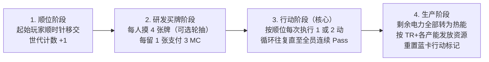

# 《殖民火星》（Terraforming Mars）全盘玩法调研与底层机制拆解

《殖民火星》（Jacob Fryxelius 设计，2016 年出版）是现代策略游戏中将**卡牌驱动构筑（Tableau / Engine Building）**与**长线资源运营**融合得最成熟的标杆作品之一。本报告从规则闭环、微回合行动博弈、资源异质化设计、底层数值定价公式、卡牌条件网、单人 PvE 与双人 1v1 PvP 的生态差异，以及扩展包试错得失七个维度做完整拆解，作为后续原创设计的方法论底盘。

---

## 一、 顶层胜负框架与 42 步全局共享时钟

游戏的核心叙事与机制高度合一：多名跨国企业共同推进火星地球化改造，在改造完成的那一世代结束对局，按总胜利分（VP）决出胜者。

### 1. 三大全局参数（Shared Global Parameters）
中央版图设有三项共享指标，合计正好包含 **42 次全局推进步骤**（即全桌总共可瓜分 42 点改造度红利）：

| 全局指标 | 起始刻度 | 终局满格刻度 | 每格跨度 | 总步数 | 常规推进途径 |
| :--- | :---: | :---: | :---: | :---: | :--- |
| **温度（Temperature）** | $-30^\circ\text{C}$ | $+8^\circ\text{C}$ | $+2^\circ\text{C}$ | **19 步** | 8 点热能转化 / 标准项目“小行星”（14 MC）/ 红绿蓝项目卡 |
| **氧气（Oxygen）** | $0\%$ | $14\%$ | $+1\%$ | **14 步** | 放置绿地板块（8 植物转化或 23 MC 标准项目）/ 微生物与钢铁炼制蓝卡 |
| **海洋（Oceans）** | 0 块 | 9 块 | 1 块板块 | **9 步** | 标准项目“引水层”（18 MC）/ 太空事件卡或条件卡 |

**终局触发铁律**：唯有**三项参数全部推至满格**，当前世代才会成为最后一个世代（该世代的行动阶段与生产阶段仍会完整走完，并额外结算最后一轮铺绿地机会，随后进入终局计分）。

### 2. 轨道节点的跨轴奖励（Track Bonus Steps）
三根进度条在特定刻度埋设了**“谁踩到谁独享”**的即时红利，甚至存在跨轨道连锁：
- **温度轨红利**：推至 $-24^\circ\text{C}$ 奖励 **+1 热能产能**；推至 $-20^\circ\text{C}$ 再奖励 **+1 热能产能**；推至 $0^\circ\text{C}$ 直接奖励 **免费放置 1 块海洋板块**（同时再拿 1 点改造度与版图格奖励）。
- **氧气轨红利**：推至 $8\%$ 时，直接联动奖励 **提升 1 格温度**（若恰好把温度顶上 $0^\circ\text{C}$，还会二次触发免费海洋，一动三吃）。

> [!TIP]
> **机制巧思**：在平滑进度条中插入离散的“大奖刻度”，让玩家在接近红利格前一格时不敢轻易垫刀（生怕给下家做嫁衣），凭空制造出激烈的时机卡位。

### 3. 改造度（Terraform Rating, TR）的一石二鸟定位
每位玩家初始拥有 `20 TR`（单人模式为 `14 TR`）。每当你将三大全局参数中的任意一项向上推 1 格（或打出直接 `+TR` 的卡牌），你的 `TR` 立即 `+1`。  
`TR` 同时承担两项核心职能：
1. **经济保底基数**：每个世代生产阶段，你固定获得等同于当前 `TR` 数值的通用货币 `MC`；
2. **终局基础底分**：游戏结束时，当前 `TR` 数值直接 `1:1` 计为你的基础胜利分（VP）。

---

## 二、 世代循环与「1～2 动微回合」节奏博弈

游戏的一个大回合称为一个**世代（Generation）**，标准多人局通常持续 **8～11 个世代**。除第 1 世代跳过前两步外，每个世代严格按四个阶段运转：

### 核心细节拆解：
1. **「买牌留牌费（3 MC/张）」的现金流紧箍咒**  
   《殖民火星》的抽牌并非免费进手，摸到的 4 张牌里想留进手牌的每张都要先交 **3 MC 专利购买费**（事后若反悔想卖掉，只能通过标准项目“出售专利”换回 **1 MC**，净亏 2 MC）。  
   这一设定直接惩罚了“无脑全留好牌”的贪婪行为：第 1～2 世代如果花 12 MC 留满 4 张后期高费牌，当回合就会因为缺钱少拍一张核心产能卡，导致后续七八个世代的复利全面崩盘。
2. **「每次只做 1 动或 2 动」的微回合（Micro-Turn）心理战**  
   行动阶段提供了 7 类合法动作（打手牌、点标准项目、激活蓝卡技能、8 植物转绿地、8 热能升温、宣称里程碑、资助奖项）。玩家每次轮到自己时，**可以选择做 2 动求快，也可以故意只做 1 动（俗称 Stalling / 拖回合）**，只要未宣布 Pass，下一圈依然轮得到自己；一旦宣布 Pass，本世代彻底退出行动。  
   这套微回合交错机制撑起了整款游戏的临场交互：
   - **憋后手防针对（Plant Sniping 攻防）**：手握 7～8 棵植物时若过早花光行动 Pass，对手就能在你无法操作的情况下悠闲砸下陨石红卡炸光你的植物；反之，高手会用低成本蓝卡技能每次只走 1 动拖延，逼对手先交完手牌 Pass，自己在世代末尾安全铺绿或偷抢里程碑。
   - **等别人先开锁**：手里捏着“要求 3 块海洋才能打”的强卡，当前场上已有 2 块海洋时，故意每次 1 动磨蹭，等对手忍不住先铺第 3 块海洋，自己立刻无缝拍下强卡。

---

## 三、 六大主资源与卡面微型资源的异质化架构

玩家面板共有 6 种基础资源，每种资源均区分**「库存（Stock，方块停在图像区）」**与**「产能（Production，方块停在棕色刻度轨）」**。它们并非换皮的六色法力，在规则上被切分为三个截然不同的职能层：

| 职能分层 | 资源名称 | 产能下限 | 核心规则与独特物理性格 |
| :--- | :--- | :---: | :--- |
| **1. 全能主通货** | **兆信用点（MC）** | **-5** | 唯一全流通货币（买牌、打牌、标准项目、抢里程碑/奖项通吃）；也是**唯一允许产能跌破 0（最低至 -5）**的资源，使许多廉价强卡可以用“-1/-2 MC 产能”作为贴合商业贷款逻辑的软代价。 |
| **2. 定向折价券** | **钢铁（Steel）** | 0 | 仅在打出带 **【建筑】** 标签的牌时可用，默认 `1 钢 = 2 MC`（不可逆兑现金，超额支付不找零）。 |
| **2. 定向折价券** | **钛金属（Titanium）** | 0 | 仅在打出带 **【太空】** 标签的牌时可用，默认 `1 钛 = 3 MC`（同样不可找零，特定蓝卡如《高级合金》可使钢钛单价各 +1 MC）。 |
| **3. 轨道转化链** | **植物（Plants）** | 0 | 满 **8 棵植物**可消耗 1 动铺设 1 块绿地板块（氧气 +1%、TR +1、终局板块本身值 1 VP 且给相邻城市 +1 VP）。最易成为红卡天灾/食肉动物的破坏标靶。 |
| **3. 轨道转化链** | **电力（Energy）** | 0 | 工业与城市的基石（大量建筑卡、造城卡要求**永久扣减 1～2 点电力产能**作为前置成本，部分蓝卡每回合耗电抽牌/炼钢）；**生产阶段开始时，所有未用完的电力库存强制清空并 1:1 转化为热能**。 |
| **3. 轨道转化链** | **热能（Heat）** | 0 | 满 **8 点热能**可消耗 1 动提升 1 格温度（TR +1）。可跨世代无限囤积，但一旦全局温度满格，剩余热能与热能产能若无特定卡牌转化，价值瞬间归零。 |

### 第七类隐性资源：蓝卡专属承载物（Card-Hosted Resources）
除了面板上的 6 种资源外，游戏把**微生物、动物、科学标记、浮空器、战斗机**等小众资源直接放在具体蓝卡卡面上：
- **界面零负担**：不占用每个玩家的常驻个人面板；
- **独立得分闭环**：例如《食肉动物》《生态区》每叠放 1 个动物标记＝终局 `1 VP`；《嗜极菌》每 2 个微生物标记＝`1 VP`；部分蓝卡可把叠在卡上的微生物直接吃掉换取升氧或 `TR`。

---

## 四、 底层数值定价模型（以 MC 为锚的量化公式）

高水平玩家社群与官方设计逻辑高度吻合，所有卡牌收益都可以折算为统一的 **`MC` 当量**（以标准 9～10 世代对局估算）：

### 1. 真实卡牌成本公式
$$\text{单卡真实总成本} = \text{卡面左上角打出费用} + 3\text{ MC（研发留牌费）}$$
*(注：若开局奖励或卡牌效果注明“摸 X 张牌”，因免去了 3 MC 留牌费，每摸 1 张牌的理论价值约为 `3.5～4 MC`。)*

### 2. 标准数值锚点表
| 收益项 | 理论折算基准（MC） | 随世代推进的价值衰减曲线 |
| :--- | :---: | :--- |
| **1 点 MC 产能** | **4.5 ～ 5 MC** | G1～G3 极高（可回本 7～9 MC）；G7 以后低于成本，G9 价值为 0。 |
| **1 点钢铁产能** | **7 ～ 8 MC** | 产出面值 2 MC/世代，但受限于手里必须摸到建筑牌，按约八折流动性折算。 |
| **1 点钛金属产能** | **10 ～ 12 MC** | 产出面值 3 MC/世代，配合太空大牌与太空减费极具爆发力。 |
| **1 点电力产能** | **7 MC** | 许多高收益建筑卡硬性要求扣电产，早期缺电会直接卡死整套工业牌。 |
| **1 点热能产能** | **6 MC** | 8 热换 1 TR，产出稳定不吃牌序，但温度见顶即报废。 |
| **1 点植物产能** | **10 ～ 12 MC** | 8 植物换绿地（1 TR + 板块 1 VP + 相邻城加分 + 版图返利），综合回报最高但怕被砸。 |
| **1 点改造度（TR）** | **9 ～ 10 MC** | 含“后续每世代 +1 MC 收入”与“终局 +1 VP”；早期值 12+ MC，末世代固定值 6 MC。 |
| **终局 1 点纯分数（VP）** | **5 MC** | 前期抓纯分牌属于自断经脉（压死复利空间）；最后两世代 `5 MC = 1 VP` 是合格转化率。 |

### 3. 标准项目（Standard Projects）的「溢价保底阀」定位
任何玩家随时可用纯 `MC` 执行的公共保底动作，定价全部**故意比同类卡牌贵出 3～5 MC**：
- **建发电厂（11 MC → +1 电产）**：对比基准价 7 MC，溢价 **+4 MC**；
- **小行星升温（14 MC → 温度+1, TR+1）**：对比基准价 10 MC，溢价 **+4 MC**；
- **引水铺海（18 MC → 铺 1 海, TR+1, 拿版图格返利约 4 MC）**：溢价约 **+4 MC**；
- **造林（23 MC → 铺 1 绿地, 氧气+1, TR+1）** / **建城（25 MC → 铺 1 城, MC 产能+1）**：均溢价约 **+4～5 MC**。

> [!IMPORTANT]
> **系统设计启示**：标准项目解决了卡牌游戏最致命的“鬼抽卡死”问题——哪怕一手烂牌，玩家也能多花点冤枉钱强行补电产或推满最后一格终局条；而 4 MC 的固定溢价又保证了“组牌打配合永远比无脑点公共按钮赚”。

---

## 五、 卡牌三色分类、双向前置锁与 11 类标签网

基础版加时代扩展共 208 张不重复项目卡，靠三色形态与标签条件织成严密网络：

### 1. 三色卡牌分工
- **绿卡（Automated 自动化产线牌）**：打出结算即时效果与产能变动后，叠放在一起仅露出顶部的**标签栏**。承担前期基建、垫标签任务。
- **蓝卡（Active 常驻引擎/行动牌）**：平铺展示在桌面，分两类——**常驻被动光环**（如“所有牌减 2 费”“每打一张地球牌返现”“钢钛升值”）与**每世代限用一次的主动技能**（如“花 1 电摸 1 牌”“往本卡叠 1 个动物得 1 分”）。蓝卡是整个滚雪球爽感的核心发动机。
- **红卡（Event 一次性事件牌）**：诸如天体撞击、贿赂、破坏、紧急升温，结算完后**面朝下翻扣进事件堆**——其顶部的太空/地球等标签只在打出的瞬间触发一次联动（比如享受钛金属支付和太空事件返现），**打出后不再计入桌面常驻标签数**，防止一次性爆发牌顺带无成本叠高标签滚雪球。

### 2. 双向前置条件（Min 下限解锁 vs Max 上限绝版）
- **下限要求（Minimum，白底红框）**：如《藻类》要求 `海洋 ≥ 5`、《食草动物》要求 `氧气 ≥ 8%`、《反重力技术》（全卡 -2 费神卡）要求自身桌面已有 `7 个科学标签`。通过高门槛锁住超模收益，赋予游戏清晰的早中晚阶段感。
- **上限要求（Maximum，棕红渐变框）**：如《古细菌》要求 `温度 ≤ -18°C`。一旦全局轨道跨过该刻度，这张牌就彻底失去打出资格——在多人博弈中，抢推某根轨道可以直接“憋死”对手手里还没来得及打出的上限卡。

### 3. 标签生态位（Tags）
标签本身不产任何数值，却把孤立单卡串成了流派：
- **【建筑】【太空】**：绑定钢、钛折价支付，是重工业基建流与太空事件爆发流的主轴；
- **【科学】**：最典型的“滚雪球引擎锁”，大量过牌蓝卡与全局减费神卡都要求 `2～7 个科学标签`，凑齐难、一旦凑齐手牌与费用双自由；
- **【植物】【微生物】【动物】**：中后期高密度刷分链（生态联动卡如《病毒增强器》每打一张三类生态牌额外送 1 植物或叠 1 生物标）；
- **【木星（Jovian）】**：大后期乘区流，多张昂贵太空卡自带“每拥有 1 个木星标签得 1 VP”，凑齐 4 张乘法结算即可瞬间斩获 16+ VP；
- **【地球】【电力】【城市】**：主要服务于前期现金流减费、工业产能转换与版图占地。

---

## 六、 版图空间占位与「里程碑 / 奖项」的零和博弈

如果只有个人面板搭产线，游戏很容易沦为“多人各算各账的单机”；《殖民火星》靠两套公共机制把玩家强行拉回同一张赌桌：

1. **六边形地图占位**：
   - 海洋只能铺在预留水区，格子上印有摸牌、钢、钛、植物等即时返利；靠着海洋铺设任意板块还能立即返现 **2 MC**。
   - **城绿相生相克**：每座城市在终局按“周围相邻的绿地板块总数（不论谁铺的！）”每块结算 `1 VP`，且两座城市默认不能紧挨着建。于是铺城流拼命把城塞进对手绿地堆里“蹭分”，铺绿流则用低成本特殊地形板块把自己的绿地围起来防蹭。
2. **里程碑（Milestones）与奖项（Awards）——超高性价比抢分池**：
   - **里程碑（5 选 3，先达标先抢，花 8 MC 锁死 5 VP）**：基础版含“35 TR”“场上有 3 座城”“场上有 3 块绿地”“8 个建筑标签”“手牌满 16 张”。名额全桌总共只有 **3 个**，一旦被抢满其余全部关闭。
   - **奖项（全桌限开 3 个，开奖费递增为 8 / 14 / 20 MC，终局结算该项第一名得 5 VP）**：基础版比拼版图板块数、MC 产能、科学标签数、热能库存、钢钛库存。允许玩家提前花 8 MC 押注自己擅长的赛道，甚至看到对手出资 20 MC 开了某个奖后，最后两世代故意猛堆该项反超“偷奖”。

---

## 七、 单人 PvE 与双人 1v1 PvP 的生态反差与固有缺陷复盘

这一部分对设计兼具 **PvE + PvP** 的策略卡牌游戏最具参考价值：

### 1. 单人 PvE 的两种成熟形态
- **经典 14 世代改造模式（加《序幕》则为 12 世代）**：初始 `14 TR`、全产能为 0，禁用里程碑与奖项。玩家必须在第 14 世代结束前把**温度、氧气、海洋三轨全部推满**，差任何一格都直接判负；推满通关后才统计总 VP 衡量打法上限。
- **TR63 竞速模式**：不强求推满三轨，改要求在死限世代内将自身 `TR` 硬推至 `63` 以上（开放 `16 MC → +1 TR` 的专属标准项目兜底），更鼓励多元提 TR 卡牌而非死磕固定轨道。

### 2. 双人 1v1 PvP 暴露出的四大底层缺陷（前车之鉴）

> [!WARNING]
> 《殖民火星》最佳人数公认为 **3～4 人**；一旦进入 **1v1 双人对局**，其底层数学模型会暴露出四个在电子竞技化/双人对弈设计中必须规避的结构痛点：

1. **「推终局者给发育者打工」的快慢速失衡（Rush vs Engine 悖论）**  
   4 人局里四双手一起推 42 格轨道，对局天然在 8～9 世代收尾，快攻改造流与科技引擎流胜率均衡。  
   但在 1v1 里，仅靠快攻方一人独自去推 42 格轨道成本极高，世代数极易被拖到 **11～13 世代**。一旦回合拉长，线性得分的快攻流根本算不过指数膨胀的“过牌+减费引擎流”；更致命的是，快攻方辛苦推高温度和氧气，反而免费帮对面解锁了高门槛的后期刷分大牌。
2. **200+ 单卡大牌堆的发牌方差过大**  
   由于原版没有局外自组套牌机制，全靠 200 多张大牌堆盲摸或两人互传轮抽：一方开局摸到低费产能+过牌核心就能顺滑起飞，另一方若前两世代摸满高费动物牌、木星牌直接卡手崩盘。在 1v1 零和对抗中，这种“起手定生死”的挫败感远比四人欢乐局强烈。
3. **满轨后的死资源陷阱（Dead Resource）**  
   一旦温度轨提前见顶，玩家辛苦搭起来的“热能产能”若没摸到特定转化蓝卡，在剩余世代里直接变成零收益废铁，缺乏系统自带的溢出转化出口。
4. **里程碑/奖项在 1v1 中的零和滚雪球过猛**  
   3 人以上时第二名还能分到 `2 VP` 奖项安慰分；在 1v1 里没有第二名奖励，抢下 1 个里程碑或反超 1 个奖项直接造成 **10 VP（相当于 50 MC 经济差距）** 的正负对冲，顺风方极易靠钱多提前锁死 3 个里程碑+3 个奖项把逆风方彻底按死。

---

## 八、 五大官方扩展的设计试错启示

| 扩展名称 | 核心改动 | 成功经验与踩坑教训 |
| :--- | :--- | :--- |
| **《序幕 Prelude》** | 开局额外发 4 选 2 免费强力启动卡，单人缩减 2 世代 | **最成功的减法式补丁**：零额外规则负担，直接砍掉第 1～2 世代“大家没钱干瞪眼”的垃圾时间，让玩家第 1 回合就确立流派方向、单局缩短 20～30 分钟。 |
| **《赫拉斯与极乐世界》** | 两张全新地图 + 全新里程碑与奖项组合 | **极高性价比的关卡变体**：不改一张卡牌，仅靠更换“版图奖励分布 + 里程碑/奖项考题”，就彻底改变了哪些流派强势，极具关卡复用启发。 |
| **《殖民地 Colonies》** | 场外贸易站，每世代派舰队抢先手提货 | 有效缓解了缺钛、缺电时的卡手，强化了回合先手抢资源的紧迫感。 |
| **《金星开拓 Venus Next》** | 新增第 4 根“不强制结束游戏”的金星轨与浮空器体系 | **典型的“孤岛膨胀坑”**：第 4 根条因为跟终局脱钩，没人有动力主动推；大量金星专属卡混进主牌堆后严重稀释了核心流派浓度。 |
| **《动荡 Turmoil》** | 议会席位争夺 + 提前两世代预告的全局事件卡 | “提前预告周期性全局高压事件（制裁纯贪发育玩家）”的思路极佳，但议会放小人的物理维护步骤过于繁琐，严重拖慢出牌心流。 |
