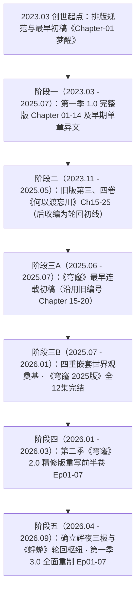

# 《苍白有瑕的囚笼》原著小说与创作演进全集（2023.03 – 2026.09）

本目录完整收录原创长篇科幻悬疑小说 **《苍白有瑕的囚笼》** 的**正篇定稿、番外群像、世界观与角色设定集、早期历史版本（废稿）以及各阶段创作中间产物**（累计全档案逾 40 万字），并严格按 **2023 年 3 月至 2026 年 9 月** 的真实创作演进时间线归档。

> 💡 **GitHub 在线免下载阅读提示**：由于 GitHub 网页端不支持直接预览 `.docx` 文档，本目录除完整保留全部原始 `.docx` 手稿（位于 `01`～`05` 目录）外，还在 [`06_GitHub在线速览版（Markdown全文本镜像）`](./06_GitHub%E5%9C%A8%E7%BA%BF%E9%80%9F%E8%A7%88%E7%89%88%EF%BC%88Markdown%E5%85%A8%E6%96%87%E6%9C%AC%E9%95%9C%E5%83%8F%EF%BC%89) 中同步生成了全文本 Markdown 镜像，点击下方表格中的 **「🌐 在线直读」** 即可直接在浏览器中阅读任意章节与大纲。

---

## 一、快速试读与浏览导航（面向评审 / 面试官）

| 推荐阅读模块 | 内容简介与核心看点 | 原始手稿目录（Word / 图稿） | GitHub 网页直接阅读 |
| :--- | :--- | :--- | :--- |
| **第一季 3.0 重制版** 《逃离圣心医院》Ep01–07 | 最新主力定稿。地下纯白病房、玛茵之脑、双向隐瞒的欧·亨利式博弈与《无选择的糖》人性试炼 | [`01_正篇定稿_最新主线/Season01...`](./01_%E6%AD%A3%E7%AF%87%E5%AE%9A%E7%A8%BF_%E6%9C%80%E6%96%B0%E4%B8%BB%E7%BA%BF/Season01_%E9%80%83%E7%A6%BB%E5%9C%A3%E5%BF%83%E5%8C%BB%E9%99%A2%EF%BC%882026.04-09_3.0%E9%87%8D%E5%88%B6%E7%89%88_Ep01-07%EF%BC%89) | [🌐 在线直读 Ep01–07](./06_GitHub%E5%9C%A8%E7%BA%BF%E9%80%9F%E8%A7%88%E7%89%88%EF%BC%88Markdown%E5%85%A8%E6%96%87%E6%9C%AC%E9%95%9C%E5%83%8F%EF%BC%89/01_%E6%AD%A3%E7%AF%87%E5%AE%9A%E7%A8%BF_%E6%9C%80%E6%96%B0%E4%B8%BB%E7%BA%BF/Season01_%E9%80%83%E7%A6%BB%E5%9C%A3%E5%BF%83%E5%8C%BB%E9%99%A2%EF%BC%882026.04-09_3.0%E9%87%8D%E5%88%B6%E7%89%88_Ep01-07%EF%BC%89) |
| **第二季 2.0 精修全卷** 《穹窿》Ep01–07 + OEp06.5–12 | 四层天幕虚拟箱庭《世界树/穹窿》群像智斗、觉醒 NPC 江小舟与跨层叙事诡计 | [`01_正篇定稿_最新主线/Season02...`](./01_%E6%AD%A3%E7%AF%87%E5%AE%9A%E7%A8%BF_%E6%9C%80%E6%96%B0%E4%B8%BB%E7%BA%BF/Season02_%E7%A9%B9%E7%AA%BF%EF%BC%882025.09-2026.03_2.0%E7%B2%BE%E4%BF%AE%E8%A1%94%E6%8E%A5%E7%89%88_%E5%85%A8%E5%8D%B7%EF%BC%89) | [🌐 在线直读《穹窿》全卷](./06_GitHub%E5%9C%A8%E7%BA%BF%E9%80%9F%E8%A7%88%E7%89%88%EF%BC%88Markdown%E5%85%A8%E6%96%87%E6%9C%AC%E9%95%9C%E5%83%8F%EF%BC%89/01_%E6%AD%A3%E7%AF%87%E5%AE%9A%E7%A8%BF_%E6%9C%80%E6%96%B0%E4%B8%BB%E7%BA%BF/Season02_%E7%A9%B9%E7%AA%BF%EF%BC%882025.09-2026.03_2.0%E7%B2%BE%E4%BF%AE%E8%A1%94%E6%8E%A5%E7%89%88_%E5%85%A8%E5%8D%B7%EF%BC%89) |
| **核心番外篇** 《忽然之间》《蜉蝣》《这个世界的她与她》 | 328 次轮回总枢纽《蜉蝣》、超级 AI「辉夜」三极哲学剧本《这个世界的她与她》 | [`02_番外篇（2025.12-2026.08）`](./02_%E7%95%AA%E5%A4%96%E7%AF%87%EF%BC%882025.12-2026.08%EF%BC%89) | [🌐 在线直读番外四篇](./06_GitHub%E5%9C%A8%E7%BA%BF%E9%80%9F%E8%A7%88%E7%89%88%EF%BC%88Markdown%E5%85%A8%E6%96%87%E6%9C%AC%E9%95%9C%E5%83%8F%EF%BC%89/02_%E7%95%AA%E5%A4%96%E7%AF%87%EF%BC%882025.12-2026.08%EF%BC%89) |
| **世界观总纲与角色设定** 四层嵌套图解 · 总大纲 · 角色书 | 四重同构嵌套世界观手绘图、四卷总大纲、单小伊与婕娜深度角色设定 | [`03_世界观大纲与角色设定...`](./03_%E4%B8%96%E7%95%8C%E8%A7%82%E5%A4%A7%E7%BA%B2%E4%B8%8E%E8%A7%92%E8%89%B2%E8%AE%BE%E5%AE%9A%EF%BC%882025.07-2026.07%EF%BC%89) | [🌐 在线直读总纲与人设](./06_GitHub%E5%9C%A8%E7%BA%BF%E9%80%9F%E8%A7%88%E7%89%88%EF%BC%88Markdown%E5%85%A8%E6%96%87%E6%9C%AC%E9%95%9C%E5%83%8F%EF%BC%89/03_%E4%B8%96%E7%95%8C%E8%A7%82%E5%A4%A7%E7%BA%B2%E4%B8%8E%E8%A7%92%E8%89%B2%E8%AE%BE%E5%AE%9A%EF%BC%882025.07-2026.07%EF%BC%89) |

---

## 二、原作三年半创作演进时间线（2023.03 — 2026.09）

### 完整时间线与档案对照总表

| 时间跨度 | 演进阶段 | 核心创作成果、废稿取舍与中间产物 | 对应归档路径 |
| :--- | :--- | :--- | :--- |
| **2023.03** | **开篇初创** | 立下《正文排版格式规范.txt》（2023-03-03），完成最早开篇初稿《Chapter-01 梦醒》（2023-03-08） | [`05_创作中间产物...`](./05_%E5%88%9B%E4%BD%9C%E4%B8%AD%E9%97%B4%E4%BA%A7%E7%89%A9%E4%B8%8E%E9%98%B6%E6%AE%B5%E6%80%A7%E6%89%8B%E7%A8%BF%EF%BC%882023.03-2026.05%EF%BC%89) |
| **2023.03 – 2025.07** | **第一季 1.0 完整版** | 完成第一季《逃离圣心医院》全 14 章（`Chapter 01–14`）；期间产出单章异文废稿《Chapter-09 人造的身体，借来的心》（2023-09）及 `Ch04`/`Ch13` 阶段修订稿 | [`04_历史版本.../阶段1_第一季1.0完整版`](./04_%E5%8E%86%E5%8F%B2%E7%89%88%E6%9C%AC%E4%B8%8E%E6%97%A9%E6%9C%9F%E5%BA%9F%E7%A8%BF%EF%BC%882023.03-2026.01%EF%BC%89/%E9%98%B6%E6%AE%B51_2023.03-2025.07_%E7%AC%AC%E4%B8%80%E5%AD%A31.0%E5%AE%8C%E6%95%B4%E7%89%88%EF%BC%88Chapter01-14%EF%BC%89) |
| **2023.11 – 2025.05** | **旧版续篇《何以渡忘川》** | 起草第三卷分卷大纲（2023-11），写完《出题篇》（`Ch15–21`）与《解题篇》（`Ch22–25`）。后为拔高格局主动废弃直续路线，并在 2026《蜉蝣》中将其收编为 328 次轮回的“最初世界线” | [`04_历史版本.../阶段2_何以渡忘川`](./04_%E5%8E%86%E5%8F%B2%E7%89%88%E6%9C%AC%E4%B8%8E%E6%97%A9%E6%9C%9F%E5%BA%9F%E7%A8%BF%EF%BC%882023.03-2026.01%EF%BC%89/%E9%98%B6%E6%AE%B52_2023.11-2025.05_%E6%97%A7%E7%89%88%E7%AC%AC%E4%B8%89%E5%9B%9B%E5%8D%B7_%E4%BD%95%E4%BB%A5%E6%B8%A1%E5%BF%98%E5%B7%9D) |
| **2025.06 – 2025.07** | **《穹窿》编号过渡初稿** | 开启《穹窿》篇章，最初仍沿用总章号命名为 `Chapter 15–20`（记录了从“连续章号”向“分季 Episode 制”转型的中间形态） | [`04_历史版本.../阶段3A_穹窿最早连载初稿`](./04_%E5%8E%86%E5%8F%B2%E7%89%88%E6%9C%AC%E4%B8%8E%E6%97%A9%E6%9C%9F%E5%BA%9F%E7%A8%BF%EF%BC%882023.03-2026.01%EF%BC%89/%E9%98%B6%E6%AE%B53A_2025.06-2025.07_%E7%A9%B9%E7%AA%BF%E6%9C%80%E6%97%A9%E8%BF%9E%E8%BD%BD%E5%88%9D%E7%A8%BF%EF%BC%88Chapter15-20%E8%BF%87%E6%B8%A1%E7%89%88%EF%BC%89) |
| **2025.07 – 2025.09** | **四重嵌套世界观奠基** | 搭建“现实创作者 ⇄ 瀚海城（辉夜）⇄ 穹窿箱庭 ⇄ 圣心医院”四层同构架构；绘出《E-07 解谜.jpg》（08-19）、《世界观图解.jpg》（09-23），写下《细节设定》与《终章·序》 | [`03_世界观大纲与角色设定`](./03_%E4%B8%96%E7%95%8C%E8%A7%82%E5%A4%A7%E7%BA%B2%E4%B8%8E%E8%A7%92%E8%89%B2%E8%AE%BE%E5%AE%9A%EF%BC%882025.07-2026.07%EF%BC%89) |
| **2025.09 – 2026.01** | **第二季 1.0 完结初版** | 完成《穹窿 2025版》全 12 集（`Ep01–12`）、《核心人设集》、《番外-01 忽然之间》及《番外-02》前身初稿《书写之刻》（2025-12-30） | [`04_历史版本.../阶段3B_穹窿2025完整初版`](./04_%E5%8E%86%E5%8F%B2%E7%89%88%E6%9C%AC%E4%B8%8E%E6%97%A9%E6%9C%9F%E5%BA%9F%E7%A8%BF%EF%BC%882023.03-2026.01%EF%BC%89/%E9%98%B6%E6%AE%B53B_2025.09-2026.01_%E7%AC%AC%E4%BA%8C%E5%AD%A3%E7%A9%B9%E7%AA%BF2025%E5%AE%8C%E6%95%B4%E5%88%9D%E7%89%88%EF%BC%88Ep01-12%EF%BC%89) |
| **2026.01 – 2026.03** | **第二季 2.0 精修版** | 大幅重修《穹窿》前半卷 `Episode 01–07`（重构《旅原的贪欢》《童年的尾声》《旷野的呼吿》《命定的棋局》），衔接后半卷 `OEp06.5–12` | [`01_正篇定稿.../Season02_穹窿`](./01_%E6%AD%A3%E7%AF%87%E5%AE%9A%E7%A8%BF_%E6%9C%80%E6%96%B0%E4%B8%BB%E7%BA%BF/Season02_%E7%A9%B9%E7%AA%BF%EF%BC%882025.09-2026.03_2.0%E7%B2%BE%E4%BF%AE%E8%A1%94%E6%8E%A5%E7%89%88_%E5%85%A8%E5%8D%B7%EF%BC%89) |
| **2026.04 – 2026.09** | **第一季 3.0 全面重制与总纲闭环** | 产出四月阶段稿与《Ep1–4 阶段合集.pdf》、人物心理推演手记《temp-episode-05》；扩写新版《全书总大纲》《婕娜人设》《单小伊角色书》及《番外-02 蜉蝣》《番外-03 这个世界的她与她》《番外-04》；完成第一季 3.0 版 `Episode 01–07` | [`01_正篇定稿.../Season01`](./01_%E6%AD%A3%E7%AF%87%E5%AE%9A%E7%A8%BF_%E6%9C%80%E6%96%B0%E4%B8%BB%E7%BA%BF/Season01_%E9%80%83%E7%A6%BB%E5%9C%A3%E5%BF%83%E5%8C%BB%E9%99%A2%EF%BC%882026.04-09_3.0%E9%87%8D%E5%88%B6%E7%89%88_Ep01-07%EF%BC%89) · [`02_番外篇`](./02_%E7%95%AA%E5%A4%96%E7%AF%87%EF%BC%882025.12-2026.08%EF%BC%89) · [`05_创作中间产物`](./05_%E5%88%9B%E4%BD%9C%E4%B8%AD%E9%97%B4%E4%BA%A7%E7%89%A9%E4%B8%8E%E9%98%B6%E6%AE%B5%E6%80%A7%E6%89%8B%E7%A8%BF%EF%BC%882023.03-2026.05%EF%BC%89) |

---

## 三、目录结构说明

- **`01_正篇定稿_最新主线/`**：当前代表最高完成度与最新设定的第一季（3.0 重制版）与第二季（2.0 精修衔接全卷）。
- **`02_番外篇（2025.12-2026.08）/`**：补完世界观时间线、轮回机制与角色群像的四部番外。
- **`03_世界观大纲与角色设定（2025.07-2026.07）/`**：全书总大纲、架构简纲、手绘世界观架构图与核心人物设定文档。
- **`04_历史版本与早期废稿（2023.03-2026.01）/`**：按创作阶段完整封存的第一季 1.0 全本（14 章）、旧版第三/四卷《何以渡忘川》（11 章+大纲）、《穹窿》连载过渡稿（6 章）与《穹窿 2025 完整初版》（12 集）。
- **`05_创作中间产物与阶段性手稿（2023.03-2026.05）/`**：2023 开篇初稿《梦醒》、排版规范、《书写之刻》初稿、重制版四月阶段稿、阶段合集 PDF 与人物心理揣摩手记。
- **`06_GitHub在线速览版（Markdown全文本镜像）/`**：对应上述全部文字档案的 UTF-8 Markdown 在线阅读版本。
